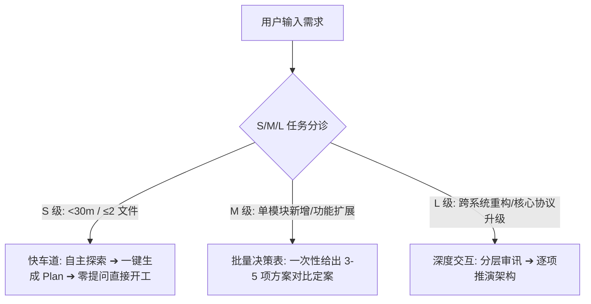

# Nightowl 技能与 CLI 底层架构重构方案
## (Actionable Architectural Refactor Plan: Usability & Availability)

> **设计基准**：基于 Codex 与 OpenCode 异构 Agent 联合审计报告 (`docs/SKILLS_USABILITY_AND_AVAILABILITY_AUDIT.md`)  
> **设计目标**：
> 1. **消灭规约虚标 (Zero Spec-Gap)**：代码未实现的能力严禁写在技能文档中冒充保障；已宣称的核心能力（如 `feedback.json`、作弊拦截）在 CLI 真实落地。
> 2. **注意力吝啬与工效学提升 (Attention Budget Optimization)**：将复杂分支与状态机下沉至 CLI；消除过度交互；提供可直接复制的 Next Action。
> 3. **生产级高可用防御 (Industrial HA)**：多实例 Lease 互斥、进程组级孤儿进程回收、worktree 容灾安全、状态机事务化。

---

## 一、 四大核心技能 (Skills) 重构方案

### 1. `skills/nightowl-plan/SKILL.md`：引入 S/M/L 分诊与快车道机制

#### 【现有痛点】
强制“每一题都必须遵守、一次只问一题、每题 2-4 选项”，在极小修改（如 Typo、单个配置调整）时产生严重的交互疲劳，开发者宁愿弃用。

#### 【修改方案与 Before/After 对比】



* **分诊标准定义**：
  * **S 级（快车道）**：无需任何提问，主代理自行阅读代码，直接生成 `.nightowl/pool.json` 与 `PROMPT.md`，并在末尾给出一句话“已就绪，回复‘开工’即可”。
  * **M 级（中型任务）**：严禁机械的一问一答，改为**“勘察总结 + 批量决策表”**（单次交互给全架构选项并标明 Recommended 项）。
  * **L 级（重型架构）**：保留分步审讯，但必须附带当前代码库的上下文事实依据。
* **门禁指令自动生成规范**：
  * 建任务时必须显式注入至少两条阶梯命令（L1 类型/语法 + L2 目标单测），禁止生成纯文本或无 `--verify` 门禁的任务。

---

### 2. `skills/nightowl-run/SKILL.md`：400 行极致瘦身与逻辑下沉

#### 【现有痛点】
400+ 行的大型 Prompt 强迫 Agent 扮演底层操作系统内核，维护平台判定、分支分类、supervise 解析，导致第 3 个任务后注意力崩溃并严重漂移。

#### 【修改方案】
* **瘦身 80%（目标 ≤ 80 行）**：
  * 将“已跟踪 vs 未跟踪文件分类决策树”下沉至 `nightowl selfcheck` 自动处理并给出直接动作；
  * 将“异构平台 worktree 生命周期与合并逻辑”彻底封装至 `nightowl worktree` CLI；
  * 技能文档仅保留核心心智模型与单行调度命令：
    ```markdown
    1. 自检: nightowl selfcheck (确保 bypass 且工作区安全)
    2. 循环: 获取任务 nightowl next ➔ 隔离开发 nightowl worktree setup <id> ➔ 验证门禁 nightowl verify <id> ➔ 合并 nightowl worktree merge <id> ➔ 收尾 cleanup
    3. 异常: 遇阻直接运行报错中的 "↪ 下一步" 命令
    ```

---

### 3. `skills/nightowl-verify/SKILL.md`：真实落地契约与消除双轨路径

#### 【现有痛点】
文档中宣称的“生成 `feedback.json`、测试作弊检查、L0-L3 门禁”在 CLI 中完全缺失；`--dir` 与 `--cwd` 相对路径计算割裂。

#### 【修改方案】
* **对齐 CLI 实现**：
  * 在 CLI 端真实落盘 `.nightowl/tasks/<id>/feedback.json`；
  * 引入作弊初检（测试全 skip 判定为 FAIL）；
  * 统一使用 `nightowl verify <id>`：CLI 内部自动根据 `id` 推导 `worktrees/<id>` 路径，彻底废弃需要手动计算的 `--cwd`。

---

### 4. `skills/nightowl-report/SKILL.md`：引入 10 秒决策看板与 Git 聚合

#### 【现有痛点】
缺乏决策价值，Stale Report 残留污染，管理者无法获知发版风险和工时偏差。

#### 【修改方案】
* **增加“🚦 10 秒发版决策看板 (Executive Summary)”**：
  * 明确给出发版判定（✅ 可发版 / 🚫 阻塞中）；
  * 任务总耗时 vs 预估耗时偏差率；
  * 平均审查打回轮次与震荡任务告警；
  * Git log 按照 `[#<id>]` 聚合呈现，过滤掉嘈杂的合并噪音。

---

## 二、 底层 CLI 核心代码修改方案

### 1. 验证命令 (`src/commands/verify.ts`)
```ts
// 核心改动 1: 支持 --id 自动推导 worktree 路径
// 核心改动 2: 真实写入 .nightowl/tasks/<id>/feedback.json
// 核心改动 3: 作弊拦截 —— 检测全 skip / 0 通过测试用例

export interface FeedbackEnvelope {
  taskId: string;
  gate: string;
  command: string;
  status: 'PASS' | 'FAIL';
  exitCode: number;
  diagnostic: string;
  recommendedActions: string[];
  timestamp: string;
}

// 拦截全 skip: 检查 stdout 中是否包含 "0 passed", "all skipped", "no tests found"
function detectEmptyOrSkippedTests(output: string): boolean {
  return /0 passed/i.test(output) || /all tests skipped/i.test(output);
}
```

### 2. 工作树命令 (`src/commands/worktree.ts`)
* **修改 `cleanup` 默认行为**：
  * 将 `-f, --force` 默认值由 `true` 改为 `false`；
  * 若存在未提交的修改且未显式指定 `--force`，拒绝删除并提示：
    ```
    ❌ WORKTREE_DIRTY: worktree 存在未提交修改，已阻止清理以防代码丢失。
       ↪ 下一步: cd worktrees/<id> && git status
       ↪ 确认放弃: nightowl worktree cleanup <id> --force
    ```
* **修复 `setup` 半死锁**：
  * 若目录存在但非有效的 git worktree（孤儿空目录），自动进行安全自愈回收，不再死锁阻断。

### 3. 清扫命令 (`src/commands/sweep.ts`)
* **消灭吞错报喜**：
  * 移除 `if (wt.code !== 0) { console.log('SWEEP_CLEAN'); return; }`；
  * 遇到 git 命令失败必须通过 `console.error` 输出失败原因并 `process.exit(1)`。

### 4. 报告命令 (`src/commands/report.ts`)
* **防 Stale Report 污染**：
  * 每次 `add` 或任务状态变更时，清理旧 report 文件；
  * Report 头部增加 Executive Summary 决策块，计算 `actual_min` 与 `est_min` 偏差率。

### 5. 进程组与超时防御 (`src/git.ts`)
* **进程树级回收**：
  * 在 Linux 环境下，针对 `runShell` 执行测试时，开启独立进程组 `detached: true`；
  * 超时或异常中断时，向整个进程组发送 `process.kill(-pid, 'SIGKILL')`，彻底清除孤儿测试进程。

### 6. 全局 Error Envelope 规范
所有 CLI 阻断报错一律格式化为统一结构：
```text
❌ <简要说明> (<ERROR_CODE>)
   原因: <详细技术细节>
   ↪ 下一步 (复制即用): <精确的单条修复命令>
   ↪ 兜底方案: <备选命令或排查命令>
```

---

## 三、 实施排期与分级行动清单 (Roadmap)

| 阶段 | 任务目标 | 涉及文件 | 验收标准 |
|:---:|---|---|---|
| **P0 紧急加固** | 1. 修复 `sweep` 吞错<br>2. 修复 `worktree cleanup` 默认强删问题<br>3. `verify` 落地 `feedback.json` 与测试作弊初检<br>4. CLI 统一 Error Envelope 基础自愈命令 | `src/commands/sweep.ts`<br>`src/commands/worktree.ts`<br>`src/commands/verify.ts`<br>`src/git.ts` | 单元测试验证零吞错、脏 worktree 不会被误删、全 skip 测试被驳回 |
| **P1 技能重构** | 1. `nightowl-plan` 引入 S/M/L 分诊与快车道<br>2. `nightowl-run` 400 行瘦身至 80 行<br>3. `nightowl-verify` 废除 `--cwd` 改为 `--id` 自动定位<br>4. `nightowl-report` 落地 10 秒发版决策看板 | `skills/nightowl-plan/SKILL.md`<br>`skills/nightowl-run/SKILL.md`<br>`skills/nightowl-verify/SKILL.md`<br>`skills/nightowl-report/SKILL.md`<br>`src/commands/report.ts` | 技能文档清晰直观，Agent 长会话零指令漂移，测试套件全绿 |
| **P2 企业级自治** | 1. Supervisor 全局单实例 Lease 锁<br>2. Patch Hash 反震荡守卫<br>3. 状态机事务化与 generation 递增 | `src/commands/supervise.ts`<br>`src/state.ts` | 双 supervisor 实例互斥，重复 patch 自动阻断 |
