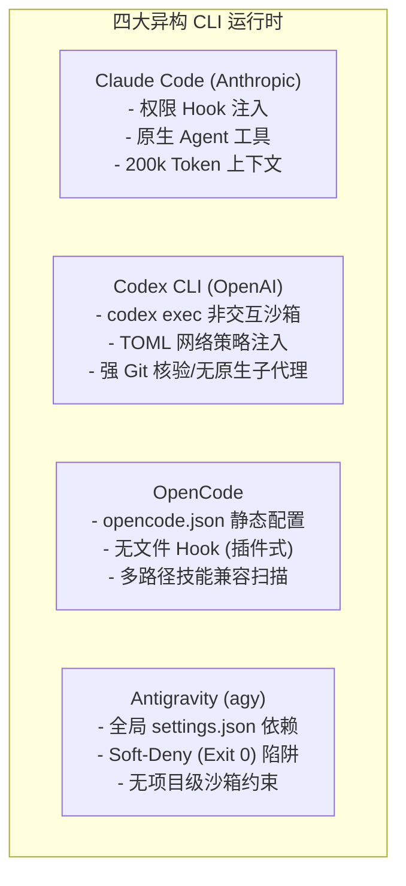
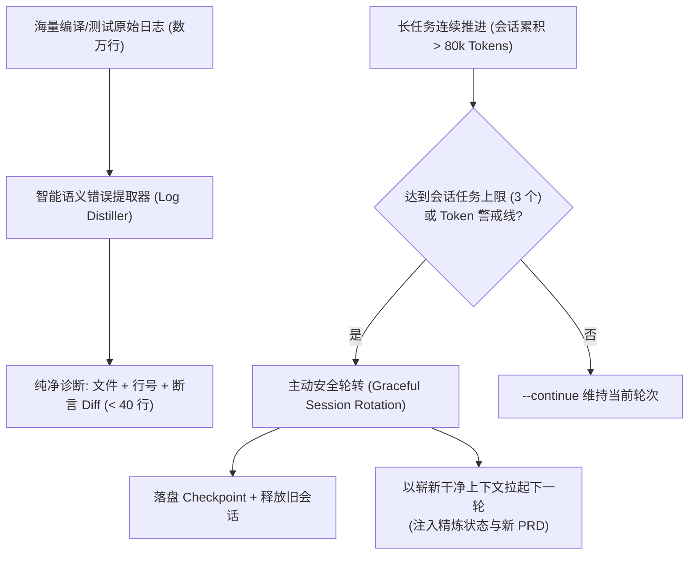

# Nightowl 技能体系完备性、异构 CLI 适配与生产级闭环演进全景报告
## (Comprehensive Skills Evaluation, Heterogeneous CLI Audit & Production Architecture Roadmap)

> **报告版本**：v1.0.0 (Production Architecture Review)  
> **审计基准**：Nightowl v0.4.2 (177 Unit Tests Passing)  
> **评审发起方**：Nightowl 架构委员会与多 Agent 联合评审团队  
> **交付目标路径**：`docs/SKILLS_EVALUATION_AND_ROADMAP.md`  
> **审查范围**：`skills/`（`nightowl-plan`、`nightowl-run`、`nightowl-report`）、`src/platforms/`（Claude、Codex、OpenCode、Antigravity）、`src/commands/`、`src/git.ts`、`src/state.ts`、调度与持久化机制及真实长任务可用性压测推演  

---

## 目录 (Table of Contents)

1. [执行摘要与联合评审团队架构 (Executive Summary & Review Team Composition)](#1-执行摘要与联合评审团队架构)
   - [1.1 评审背景与宏观结论](#11-评审背景与宏观结论)
   - [1.2 联合评审团队多视角构成与职责矩阵](#12-联合评审团队多视角构成与职责矩阵)
2. [R1：现有技能链全生命周期与可用性审计 (Skills Lifecycle & Usability Audit)](#2-r1现有技能链全生命周期与可用性审计)
   - [2.1 技能定义、模板渲染与铺装机制](#21-技能定义模板渲染与铺装机制)
   - [2.2 运行期编排模型与核心假定审计](#22-运行期编排模型与核心假定审计)
   - [2.3 无人值守/静默执行的致命脆弱点深度审计 (含精确代码定位)](#23-无人值守静默执行的致命脆弱点深度审计)
   - [2.4 典型故障推演与真实生产事故案例剖析](#24-典型故障推演与真实生产事故案例剖析)
3. [R2：异构 Agent 运行视角深度联合研讨 (Heterogeneous Agent Perspectives)](#3-r2异构-agent-运行视角深度联合研讨)
   - [3.1 Claude Code 视角：权限机制、紧凑上下文与原生 Worktree 隔离](#31-claude-code-视角权限机制紧凑上下文与原生-worktree-隔离)
   - [3.2 Codex 视角：非交互式执行、沙箱网络策略与裸 Worktree 陷阱](#32-codex-视角非交互式执行沙箱网络策略与裸-worktree-陷阱)
   - [3.3 OpenCode 视角：权限映射、静默检测假阳性与技能冲突](#33-opencode-视角权限映射静默检测假阳性与技能冲突)
   - [3.4 Antigravity 视角：全局权限污染、Soft-Deny 静默死锁与沙箱漂移](#34-antigravity-视角全局权限污染soft-deny-静默死锁与沙箱漂移)
   - [3.5 异构 CLI 核心机制横向对比矩阵](#35-异构-cli-核心机制横向对比矩阵)
4. [R3：闭环架构差距分析与缺失能力规约 (Closed-Loop Gap Analysis & New Capabilities)](#4-r3闭环架构差距分析与缺失能力规约)
   - [4.1 对标业界 SOTA 自主编码 Agent 闭环模型](#41-对标业界-sota-自主编码-agent-闭环模型)
   - [4.2 独立验证与仲裁技能设计：`skills/nightowl-verify/SKILL.md` 规约](#42-独立验证与仲裁技能设计skillsnightowl-verifyskillmd-规约)
   - [4.3 分级测试金字塔 (Fail-Fast Verification Pyramid) 与 Flaky 治理](#43-分级测试金字塔-fail-fast-verification-pyramid-与-flaky-治理)
   - [4.4 长周期上下文语义压缩与主动会话轮转方案](#44-长周期上下文语义压缩与主动会话轮转方案)
   - [4.5 结构化反馈协议 (`feedback.json`) 与补丁哈希反震荡守卫](#45-结构化反馈协议-feedbackjson-与补丁哈希反震荡守卫)
   - [4.6 多 Agent 并发波次调度 (DAG Wave) 与安全回滚机制](#46-多-agent-并发波次调度-dag-wave-与安全回滚机制)
5. [R4：系统健康度与成熟度评估矩阵 (Maturity & Health Matrices)](#5-r4系统健康度与成熟度评估矩阵)
   - [5.1 技能体系成熟度雷达矩阵](#51-技能体系成熟度雷达矩阵)
   - [5.2 异构平台适配器健康度评估矩阵](#52-异构平台适配器健康度评估矩阵)
6. [R4：行动实施路线图 (Actionable Implementation Roadmap)](#6-r4行动实施路线图)
   - [6.1 P0 级：紧急可用性止血与安全防线加固 (即刻实施 / 1-3 天)](#61-p0-级紧急可用性止血与安全防线加固)
   - [6.2 P1 级：核心闭环能力补齐与原生生命周期接管 (近期演进 / 1-2 周)](#62-p1-级核心闭环能力补齐与原生生命周期接管)
   - [6.3 P2 级：企业级多 Agent 协同与高可用自治 (远期演进 / 3-4 周)](#63-p2-级企业级多-agent-协同与高可用自治)
   - [6.4 实施依赖拓扑与风险缓解总表](#64-实施依赖拓扑与风险缓解总表)
7. [复现与验证指南 (Verification & Reproduction Guide)](#7-复现与验证指南)

---

## 1. 执行摘要与联合评审团队架构

### 1.1 评审背景与宏观结论

Nightowl（v0.4.2）是一套面向大语言模型（LLM）驱动的自主软件工程研发编排技能框架。其核心理念为：**“状态外置于文件系统（State Externalized）、跨平台宿主中立（Host-Agnostic）、三阶段严密契约（Plan 交互审讯 ➔ Run 全程静默 ➔ Report 闭环收尾）”**。

在现有单机串行测试基准下，Nightowl 展现了扎实的工程规范：
- 拥有包含 19 个测试套件、177 个测试用例的端到端自动化测试体系，单测通过率 100%；
- 建立了基于单一真理源模板和 SHA256 哈希比对的幂等技能铺装系统，支持本地修改保护；
- 具备基本的断点恢复（`checkpoint` 双轮切换备份）以及基于 Git 提交标记（`[#<id>]`）的硬核验防作弊网关。

**核心联合审查结论**：  
当前 Nightowl 在**“静态契约定义”**与**“理想短会话调度”**上设计优良，但在**未进行大规模真实长任务（8~24 小时无人值守运行）与真实极端异构环境**的严苛考验下，系统暴露出了**“底层进程管控脆弱、跨工作区路径断裂、关键错误信息截断失真、文件状态竞态无锁、异构 CLI 权限语义非对称”**等一系列足以导致夜间静默执行彻底崩溃或产生虚假完成的 P0/P1 级致命漏洞。

此外，现有三阶段模型仅实现了宏观任务级串行派发，在微观任务内部严重缺失**独立的验证/仲裁技能、测试金字塔门禁、语义日志提取、补丁哈希反震荡守卫以及主动会话轮转机制**。本报告汇聚四方专家的联合研讨成果，给出全景式技术诊断与可落地的工程演进路线图。

---

### 1.2 联合评审团队多视角构成与职责矩阵

为了打破单一模型视角或单一开发者的思维盲区，本次评审组成了由四位资深专家角色的联合评审委员会：

```
┌────────────────────────────────────────────────────────────────────────┐
│                   Nightowl 多 Agent 联合评审委员会                      │
├────────────────────┬────────────────────┬──────────────────────────────┤
│ 评审专家视角       │ 专注审查领域       │ 核心关注点与输入职责         │
├────────────────────┼────────────────────┼──────────────────────────────┤
│ 1. Claude Code 专家│ 特权权限与上下文   │ PreToolUse Hook 注入性能开销 │
│    (Anthropic 系)  │ 原生 Worktree 隔离 │ 200k 上下文膨胀雪崩/指令漂移 │
│                    │ 自动化工具集成     │ commit 核验宽松豁免的历史漏洞│
├────────────────────┼────────────────────┼──────────────────────────────┤
│ 2. Codex 平台专家  │ 沙箱安全与执行规约 │ codex exec 非交互式沙箱模型  │
│    (OpenAI 系)     │ 非交互式管道通信   │ config.toml 网络策略与段落合并│
│                    │ 裸 Worktree 调度   │ 项目未受信静默挂死与目录残留 │
├────────────────────┼────────────────────┼──────────────────────────────┤
│ 3. OpenCode /      │ 异构运行时适配     │ opencode.json 静态 bypass 假阳性│
│    Antigravity 专家│ 全局权限越权风险   │ Antigravity 全局 settings 污染│
│    (生态跨端系)    │ Soft-Deny 行为     │ Soft-Deny 退出码 0 导致的假成功 │
├────────────────────┼────────────────────┼──────────────────────────────┤
│ 4. 系统与闭环架构  │ 闭环自愈与抗震荡   │ 缺失 nightowl-verify 独立技能 │
│    首席专家        │ 上下文语义压缩     │ .slice(-500) 堆栈截断信息黑洞│
│    (SOTA 对标系)   │ 并发与持久化安全   │ 状态文件无锁 (Lost Update)   │
└────────────────────┴────────────────────┴──────────────────────────────┘
```

---

## 2. R1：现有技能链全生命周期与可用性审计

### 2.1 技能定义、模板渲染与铺装机制

Nightowl 当前包含三个标准核心技能：`nightowl-plan`、`nightowl-run`、`nightowl-report`。其生命周期管理机制如下：

```mermaid
flowchart LR
    subgraph SingleSource ["单一真理源 (Single Source of Truth)"]
        T_Plan["skills/nightowl-plan/SKILL.md"]
        T_Run["skills/nightowl-run/SKILL.md"]
        T_Report["skills/nightowl-report/SKILL.md"]
    end

    subgraph Renderer ["src/platforms/render.ts (占位符动态替换)"]
        P_Ask["{{PLATFORM_ASK}}"]
        P_Relaunch["{{PLATFORM_RELAUNCH}}"]
        P_Headless["{{PLATFORM_HEADLESS}}"]
        P_Subagent["{{PLATFORM_SUBAGENT_*}}"]
        P_Push["{{PLATFORM_PUSH_MODE}}"]
    end

    subgraph Hashing ["版本与哈希追踪 (src/commands/install.ts)"]
        CalcHash["计算 SHA-256 哈希"]
        CheckMod{"目标已存在且<br>哈希不一致?"}
        Skip["跳过 (protect user edit)"]
        Write["原子覆盖写入 + 记录版本戳"]
    end

    SingleSource --> Renderer
    Renderer --> CalcHash
    CalcHash --> CheckMod
    CheckMod -- 是 (未带 --force) --> Skip
    CheckMod -- 否 / 带 --force --> Write
```

#### 2.1.1 单一真理源与占位符映射
为了避免维护 4 份独立的平台技能导致规则语义漂移，Nightowl 在 `src/platforms/render.ts:5-10` 中定义了平台占位符替换机制：
- `{{PLATFORM_ASK}}`：定义向用户交互提问的形式。Claude 使用内部工具 `AskUserQuestion`；其余平台使用纯文本逐题编号提问。
- `{{PLATFORM_RELAUNCH}}`：定义无交互启动参数（如 Claude 的 `--dangerously-skip-permissions`）。
- `{{PLATFORM_HEADLESS}}`：定义外部守护器续跑单轮指令样例。
- `{{PLATFORM_SUBAGENT_D}}` / `{{PLATFORM_SUBAGENT_CALL}}` / `{{PLATFORM_SUBAGENT_DIR}}`：定义子代理派发协议。Claude 声明 `Agent(isolation="worktree")`；其余平台指示主代理通过 Bash 裸跑 `git worktree add`。
- `{{PLATFORM_PUSH_MODE}}`：定义收尾推送的前置条件。

#### 2.1.2 铺装算法与定制内容防护
在 `src/commands/install.ts:50-88` 中：
1. 铺装时针对**替换占位符后的渲染结果**计算 SHA256，记录于 `.nightowl/.template-hashes.json`，并打上当前 npm 包版本戳 `skillsVersion`（`src/paths.ts:47-53`）；
2. 若目标文件已被开发者本地修改（当前文件 SHA256 与上次记录不符），铺装默认判定为 `skipped`，绝不静默覆盖开发者修改；只有显式携带 `--force` 参数才会覆盖；
3. `nightowl status`（`src/commands/status.ts:9-18`）会非阻断性检测 `installedVersion < pkgVersion`，适时提醒用户重跑 `nightowl init --skip-permissions` 进行无损升级。

---

### 2.2 运行期编排模型与核心假定审计

Nightowl 的调度模型在运行时具有两个关键特性：
1. **控制反转与 LLM 调度主体**：在未接入外部守护进程（`supervise`）时，**Nightowl 的调度驱动核心实际上是 LLM 自身**。模型作为一个自主循环体，自主调用 `nightowl sweep` ➔ `nightowl next` ➔ 派发子代理 ➔ 执行测试 ➔ 合并分支 ➔ `nightowl done` ➔ `nightowl report`。
2. **外部守护器兜底**：在无人值守生产场景下，使用 `nightowl supervise` 以子进程方式（`spawn`）分轮次拉起宿主 CLI 会话，注入 `SUPERVISOR_PROMPT`，驱动会话前进。

#### 核心环境假定审计：
- **假定 1：免交互环境绝对成立（Bypass Mode Assumption）**：系统假定开发者或外部环境已授予全量特权，所有终端命令和文件写入都会被宿主 CLI 静默放行。
- **假定 2：子代理严格遵守工作区隔离（Worktree Strictness Assumption）**：系统假定派发的子代理能自觉在隔离工作区（Worktree）中修改代码，不会污染主仓。
- **假定 3：单 Agent 独占文件系统（Single-Process Concurrency Assumption）**：系统假定 `.nightowl/` 目录处于单会话单进程独占态，没有并发读写。

**审计结论**：上述三大假定在真实生产长任务中**无一能够稳定成立**，直接诱发了以下严重的致命脆弱点。

---

### 2.3 无人值守/静默执行的致命脆弱点深度审计

联合评审团队对核心调度源码逐行排查，挖掘出 7 处致命与严重脆弱点：

```
┌────────────────────────────────────────────────────────────────────────┐
│               Nightowl 核心脆弱点与严重缺陷分布图                      │
├─────┬──────────────────────┬─────────┬───────────────────┬─────────────┤
│ 编号│ 代码定位             │ 风险等级│ 缺陷表现          │ 生产破坏后果│
├─────┼──────────────────────┼─────────┼───────────────────┼─────────────┤
│ 1   │ src/git.ts:12-25,    │ P0 致命 │ execFileSync 零超时│ 进程永久挂死│
│     │ src/git.ts:35-49     │         │ 控制与零管道输入  │ 调度彻底卡死│
├─────┼──────────────────────┼─────────┼───────────────────┼─────────────┤
│ 2   │ src/commands/verify  │ P0 致命 │ 验证命令无 cwd,   │ 验证主仓旧码│
│     │ .ts:28, cli.ts:19-22 │         │ --dir 强制回主仓  │ 或无配置崩溃│
├─────┼──────────────────────┼─────────┼───────────────────┼─────────────┤
│ 3   │ src/commands/super   │ P1 严重 │ kill 仅杀主 PID,   │ 孤儿子进程跑│
│     │ vise.ts:79, 266      │         │ 未解绑负 PID 组   │ 满 CPU/内存 │
├─────┼──────────────────────┼─────────┼───────────────────┼─────────────┤
│ 4   │ src/commands/verify  │ P1 严重 │ .slice(-500) 截断 │ 关键报错丢失│
│     │ .ts:30               │         │ 仅保留内部调用栈  │ 模型盲猜死循环│
├─────┼──────────────────────┼─────────┼───────────────────┼─────────────┤
│ 5   │ src/state.ts:74-79   │ P1 严重 │ 仅单写原子性,     │ 多进程并发写│
│     │                      │         │ 缺乏 cross-process│ 导致更新丢失│
├─────┼──────────────────────┼─────────┼───────────────────┼─────────────┤
│ 6   │ src/commands/done    │ P1 严重 │ platform !==      │ 虚假标记完成│
│     │ .ts:63-72            │         │ 'claude' 豁免核验 │ 丢弃未合代码│
├─────┼──────────────────────┼─────────┼───────────────────┼─────────────┤
│ 7   │ src/commands/push    │ P1 严重 │ 未注入 non-inter  │ Git 弹窗交互│
│     │ .ts:31               │         │ active 环境变量   │ 静默推送挂死│
└─────┴──────────────────────┴─────────┴───────────────────┴─────────────┘
```

#### 2.3.1 脆弱点 1：`execFileSync` 零超时控制与零管道输入导致永久挂死 (P0 致命)
- **代码位置**：`src/git.ts:10-27` (`git()`) 与 `src/git.ts:30-50` (`runShell()`)
- **源码审查**：
  ```typescript
  export function runShell(cmd: string, opts: { cwd?: string } = {}): { stdout: string; stderr: string; code: number } {
    try {
      const stdout = execFileSync(cmd, {
        cwd: opts.cwd,
        encoding: 'utf8',
        shell: true,
        stdio: ['pipe', 'pipe', 'pipe'], // 👈 缺失 timeout, 缺失 maxBuffer, stdin 未传 EOF
      });
      return { stdout, stderr: '', code: 0 };
    } catch (e: unknown) { ... }
  }
  ```
- **机理与破坏推演**：
  1. Node.js `child_process.execFileSync` 的默认参数为 `timeout: 0`（无限等待）。
  2. 若用户在 `task.verify` 中配置的验证命令包含测试框架，而测试框架偶然进入无限循环、等待死锁网络请求，或者子代理误启动了长驻服务（如 `npm run dev`、未加 `--run` 参数的交互式 `vitest`），**Node.js 进程将永远阻塞在同步调用中，整套调度流水线彻底挂死**！
  3. `stdio: ['pipe', 'pipe', 'pipe']` 使得子进程继承了管道输入，但父进程从不向其写入任何字符，也未送入 EOF。遇到任何 `Do you want to continue? [y/N]` 或 SSH 密码询问时，进程将陷入永久阻塞。
  4. 虽然 `supervise.ts` 具备整轮 `--timeout-min`（默认 30 分钟）的超时保护，但这意味着一旦发生单命令挂起，必须整整等待 30 分钟被外部 `SIGKILL` 强杀，严重破坏夜间作业时效。

#### 2.3.2 脆弱点 2：跨工作区路径断裂与测试对象错位 (P0 致命)
- **代码位置**：`src/paths.ts:15`, `src/cli.ts:19-22`, `src/commands/verify.ts:28`
- **致命时序链分析**：
  1. `paths.ts:15`：`getBaseDir()` 硬编码为 `path.join(process.cwd(), '.nightowl')`；
  2. `cli.ts:19-22`：全局 CLI 钩子设定：
     ```typescript
     program.hook('preAction', (thisCommand) => {
       const dir = thisCommand.opts().dir ?? '.';
       if (dir !== '.') process.chdir(dir);
     });
     ```
  3. `verify.ts:28`：执行命令 `const r = runShell(c);` —— **未向 `runShell` 传递任何 `cwd` 选项，默认取当前进程的 `process.cwd()`**！
- **破坏后果推演**：
  - 子代理被派发到隔离的 Git Worktree 路径（如 `.nightowl/worktrees/T1`）中编写代码；
  - 任务池文件仅位于主仓库根目录 `.nightowl/nightowl.tasks.yaml`，Worktree 内并无 `.nightowl/` 目录；
  - **情形 A（子代理在 Worktree 内运行）**：子代理在隔离区执行 `nightowl verify T1`，CLI 读不到 `.nightowl` 目录，直接报错 `common.noPool` 并以状态码 1 崩溃退出！
  - **情形 B（子代理携带 `--dir` 参数）**：子代理运行 `nightowl --dir /path/to/main verify T1`。CLI 的 `preAction` 立即执行 `process.chdir('/path/to/main')`，将当前工作目录强制切回主仓库！随后的 `runShell(c)` 在主仓执行测试。**而主仓此时根本尚未合入 Worktree 的新代码！测试命令验证的完全是老代码！新代码即使写得漏洞百出，测试也会报“全绿通过”**！

#### 2.3.3 脆弱点 3：`supervise` 孤儿孙子进程泄漏 (P1 严重)
- **代码位置**：`src/commands/supervise.ts:79` (`timeout`) 及 `src/commands/supervise.ts:266` (`onSignal`)
- **机理剖析**：
  在 `runHostRound` 中，通过 `spawn(hr.cmd, args)` 启动宿主 CLI 进程。当单轮超时或收到中断退出信号时，执行 `child.kill('SIGKILL')`。
  由于在 `spawn` 时未设置 `{ detached: true }`，并且杀死信号仅针对直接子进程（`child.pid`），由宿主 CLI 衍生出的大量孙子进程（例如 `tsc --watch`、`vitest`、`python` 编译器进程）**无法收到该信号**！
  这些子进程被 Linux 系统 init (PID 1) 进程收养，变成脱离管束的孤儿进程（Orphan Processes），持续在后台空转消耗 CPU/内存，甚至长期霸占端口和 `.git/index.lock`，导致后续轮次因资源耗尽或锁争用而持续失败。

#### 2.3.4 脆弱点 4：错误日志 `.slice(-500)` 截断导致信息盲区 (P1 严重)
- **代码位置**：`src/commands/verify.ts:30`
  ```typescript
  const tail = `${r.stdout}\n${r.stderr}`.trim().slice(-500);
  console.error(t('verify.failed', { id, code: r.code, cmd: c }));
  if (tail) console.error(tail);
  ```
- **机理与排错困境**：
  现代主流测试框架（Vitest, Jest, Pytest）以及编译器（TypeScript `tsc`）的设计，均是在错误发生时**第一时间在输出头部打印文件名、出错行号、断言差异（Expected vs Received）**。而在输出的末尾 500 个字符，绝大部分全是被跳过用例的摘要统计或者密密麻麻的 Node.js 运行时内部调用栈：
  ```text
      at Module._compile (node:internal/modules/cjs/loader:1469:14)
      at Module._extensions..js (node:internal/modules/cjs/loader:1548:10)
      at Module.load (node:internal/modules/cjs/loader:1288:32)
  ```
  `.slice(-500)` 导致子代理只能看到这 5 行无用的 V8 栈，核心报错全被丢弃。子代理因拿不到真实错误，只能靠“盲猜”修改代码，迅速耗尽 `retry_budget`（默认 2 次），任务直接被无谓冻结至 `blocked`。

#### 2.3.5 脆弱点 5：状态读写缺乏文件排他锁导致更新丢失 (P1 严重)
- **代码位置**：`src/state.ts:74-79` (`atomicWrite`)
- **机理分析**：
  ```typescript
  function atomicWrite(f: string, content: string): void {
    ensureBaseDir();
    const tmp = `${f}.tmp`;
    fs.writeFileSync(tmp, content, 'utf8');
    fs.renameSync(tmp, f);
  }
  ```
  `atomicWrite` 通过临时文件重命名保证了单次写操作的 POSIX 原子性（防止写入中断留下半拉损坏文件）。
  **但是，它没有任何跨进程文件排他锁（Advisory File Lock / flock）机制**！
  状态更新遵循“读入内存 ➔ 业务修改 ➔ 覆写回盘”模式。若存在 Supervisor 状态轮询、并发任务派发或人类交互并发，后写入的进程会无声无息地覆盖掉前一个进程刚提交的状态变更，发生经典的“更新丢失（Lost Update）”。

#### 2.3.6 脆弱点 6：Claude 平台 commit 核验豁免的假完成漏洞 (P1 严重)
- **代码位置**：`src/commands/done.ts:63-72`
- **源码审查**：
  ```typescript
  if (!taskCommitInHead(id)) {
    const platform = resolvePlatform(undefined, path.dirname(getBaseDir()));
    const strict = opts.requireCommit === true || platform.id !== 'claude';
    if (strict) {
      console.error(t('done.noCommit', { id }));
      process.exit(1);
    }
    console.log(t('done.noCommitWarn', { id })); // 👈 Claude 平台仅打印警告，放行 exit 0!
  }
  ```
- **破坏后果推演**：
  Nightowl 早期为了规避 Claude 原生 `Agent` 工具未能自动合回主分支的问题，对 Claude 平台特设了“豁免分支”。
  当 Claude 作为执行平台时，即使当前主分支 HEAD 中根本不存在带有 `[#<id>]` 标记的提交，`nightowl done` 也仅仅输出警告，依然将任务标记为 `completed` 并清除 checkpoint！在收尾 `nightowl push` 时，主分支根本没有任何新提交，导致子代理辛辛苦苦编写的代码成果**被静默丢弃**，用户拿到了一份“虚假全绿”的空报告。

#### 2.3.7 脆弱点 7：Git 推送交互阻断挂起 (P1 严重)
- **代码位置**：`src/commands/push.ts:31` (`git(['push', 'origin', branch])`)
- **机理分析**：
  在无人值守收尾阶段，系统执行 `git push origin branch`。如果远端仓库配置为 HTTPS 且凭证过期，或者首次通过 SSH 连接目标服务器触发 Host 信任交互（`Are you sure you want to continue connecting (yes/no)?`），Git 会在控制台阻塞等待终端输入。
  由于没有在执行环境中强制注入 `GIT_TERMINAL_PROMPT=0`、`GIT_ASKPASS=/bin/echo`，推送命令将在后台永久挂起，直至守护器整轮超时。

---

### 2.4 典型故障推演与真实生产事故案例剖析

#### 案例 1：夜间无人值守孤儿 Worktree 堆积与磁盘耗尽
- **真实重现场景**：某批次包含 14 个独立任务，在连续运行 8 小时期间，有 3 个任务因单元测试进入死循环触发了单轮 30 分钟超时强杀。
- **故障链条**：
  1. `supervise.ts` 超时后向宿主进程发送 `SIGKILL`；
  2. 宿主死亡，但在 `.nightowl/worktrees/T...` 中执行的死循环编译子进程未被击杀，转为后台运行；
  3. Git 内部索引仍标记该 Worktree 处于检出（locked）状态；
  4. 下一轮调度器唤起时，再次尝试创建该任务的 Worktree，Git 抛错：`fatal: 'nightowl/T2' is already checked out`；
  5. 8 小时后，工作区残留了 14 个孤儿 Worktree 目录，大量未释放的编译缓存与僵尸进程将宿主机内存占满。

#### 案例 2：Vitest 错误日志截断引发的死循环盲猜重试
- **真实重现场景**：子代理重构了数据模型，导致 `src/index.ts` 产生类型签名不匹配，`vitest run` 失败。
- **故障链条**：
  1. Vitest 输出长达 4000 字符。真正的错误 `AssertionError: expected 'active' to deeply equal 'pending'` 打印在第 15 行；
  2. `verify.ts:30` 的 `.slice(-500)` 将前 3500 字符全部截断，仅向模型返回了 Node.js 模块加载器的堆栈；
  3. 子代理在 Attempt 2 看到这 5 行加载器栈，误以为是 Node 环境异常，胡乱在 `package.json` 中修改依赖配置；
  4. Attempt 2 再次验证失败，`retry_budget`（2 次）耗尽，任务直接被标记为 `blocked`。一个只需修改一个字符串的微小错误，导致整个夜间调度停滞。

---

## 3. R2：异构 Agent 运行视角深度联合研讨

针对 Claude Code、Codex、OpenCode、Antigravity 四个主流 CLI 平台的底层执行模型与设计差异，联合评审团队进行了多视角深度审查。



### 3.1 Claude Code 视角：权限机制、紧凑上下文与原生 Worktree 隔离

#### 3.1.1 权限模式模型与 PreToolUse Hook
- **分级权限状态机**：Claude Code 内部具备 `default`、`acceptEdits`、`plan`、`dontAsk`、`bypassPermissions` 五种权限模式。
- **Nightowl 的集成实现**：
  1. 在 `src/platforms/claude.ts:13-59` 中写入 38 条白名单规则至 `.claude/settings.json`（`permissions.allow` 包含 `Bash(nightowl *)`、`Bash(git *)` 等）；
  2. 向 `.claude/settings.json` 注入 `PreToolUse` 钩子脚本 `.claude/hooks/permission-mode.mjs`；每次工具调用前拦截 stdin 传入的 Payload，将 `permission_mode` 实时持久化至 `.nightowl/.permission-mode`；
  3. `nightowl selfcheck` 读取该标记，硬核验当前是否处于 `bypass` 模式。
- **隐蔽脆弱点**：
  - `permissions.allow` 仅对 `Bash(...)` 有效。Claude 内部工具（如 `FileEdit`、`Agent`）在未设置全局特权时**仍会弹窗询问**。因此，无人值守启动参数 `--dangerously-skip-permissions` 是绝对不可或缺的强依赖；
  - **Hook 进程衍生开销**：`PreToolUse` 切面在每次工具调用时都会同步拉起一个 `node` 子进程执行 `permission-mode.mjs`。长任务中产生数百次工具调用时，频繁衍生进程会造成显著的系统调用开销与 I/O 抖动。

#### 3.1.2 紧凑上下文治理与 Token 开销控制
- **技能提示词固定开销**：`skills/nightowl-run/SKILL.md` 正文长达 **343 行（18.7 KB）**。一旦 Claude 激活该技能，按 1 KB ≈ 250 Tokens 折算，仅技能注入就消耗约 **4,500 ~ 5,000 Tokens** 的固定基线空间。
- **上下文膨胀隐患**：在 `supervise.ts:219-230` 中，每轮 headless 均携带 `--continue`：
  ```typescript
  const a = ['-p', '--dangerously-skip-permissions', '--append-system-prompt', prompt];
  if (useContinue) a.splice(1, 0, '--continue');
  ```
  `--continue` 使得会话历史单调递增。连续推进 5 个任务后，上下文极易突破 150k Tokens，导致模型推理时延急剧上升、注意力分散（Attention Drift），遗忘调度指令。

#### 3.1.3 原生 `Agent(isolation="worktree")` 与提交豁免妥协
- **机制**：Claude Code 原生提供了强大的子代理调度能力，声明 `isolation: "worktree"` 时底层会自动建立临时工作区隔离。
- **妥协危害**：正如 R1 审计所述，由于 Claude 原生子代理提交不会自动合回主分支，Nightowl 在 `src/commands/done.ts:65` 对 Claude 实行了 Commit 豁免放行。这是当前架构最大的安全妥协，必须通过 CLI 原生接管合并予以彻底纠正。

---

### 3.2 Codex 视角：非交互式执行、沙箱网络策略与裸 Worktree 陷阱

#### 3.2.1 非交互式执行指令与沙箱演进
- **命令收敛**：在新版 `codex-cli`（0.162.1+）中，`--full-auto` 已废弃，统一收敛为：
  - 首轮启动：`codex exec --sandbox workspace-write "<prompt>"`
  - 续跑接续：`codex exec resume --last "<prompt>"`
- **网络策略注入**：Codex 默认在 `workspace-write` 沙箱下**阻断外网访问**（导致 `git push`、`npm install` 失败）。Nightowl 在 `src/platforms/codex.ts:121-133` 中通过自研的高质量 TOML 段落合并算法，精准将 `[sandbox_workspace_write] network_access = true` 注入 `.codex/config.toml`，避免了段落粘连与顶层键覆盖。

#### 3.2.2 项目受信机制（Project Trust）的死锁陷阱
- **阿喀琉斯之踵**：Codex 仅当项目被用户标记为“受信（Trusted）”时，才会加载项目级 `.codex/config.toml`。
- 若在 CI/CD 或全新环境中未经前置交互直接运行 `nightowl supervise`，Codex 会静默忽略 `approval_policy = "never"`，回退到交互确认。此时子进程因 `stdio[0] = 'ignore'` 收到 EOF 或挂起，导致整轮任务无声卡死直至超时。

#### 3.2.3 裸 Worktree 调度发散与进度指纹
- **缺乏原生子代理**：Codex 没有类似 Claude 的原生隔离子代理工具。Nightowl 只能在 Prompt 中指示主代理用 Bash 手动拼装 `git worktree add`。
- **发散风险**：Codex 模型极易发生 CWD 漂移，在执行代码修改或单测时错误地在主仓直接操作，并在异常中断时残留孤儿 Worktree。
- **进度指纹双重防御**：Codex CLI 执行即便失败或零推进，退出码往往依然是 0。Nightowl 在 `supervise.ts` 中设计了 `progressSig` 进度指纹（`completed.length:blocked.length`），严格比对状态推进，连续达到 `--max-idle` 自动安全熔断，有效防御了退出码欺骗。

---

### 3.3 OpenCode 视角：权限映射、静默检测假阳性与技能冲突

#### 3.3.1 权限规则映射设计
- OpenCode 通过项目级 `opencode.json` 配置权限字典。Nightowl 在 `src/platforms/opencode.ts:73-79` 中准确注入：
  ```typescript
  const want: Record<string, unknown> = {
    bash: 'allow',
    edit: 'allow', // 规避 "write" 键，OpenCode schema 将文件写入归并为 edit
    task: 'allow',
    skill: 'allow',
  };
  ```

#### 3.3.2 致命缺陷：`detectBypass` 静态检测假阳性
- **机理分析**：OpenCode 不支持文件式 PreToolUse Hook。Nightowl 的 `detectBypassFor(cwd)` 只能静态检查 `opencode.json` 中是否存在 `bash: "allow"`（`src/platforms/opencode.ts:112-115`）。
- **假阳性破坏**：静态文件存在**绝不代表**运行时开启了免确认模式！若用户以交互模式启动 OpenCode 且未加 `--auto`，系统自检依然会误判为 `PERMISSION_MODE: bypass`。主代理收到虚假信号后误以为环境绝对安全，遇到弹窗交互拦截立即挂死。

#### 3.3.3 技能扫描路径冲突
- OpenCode 同时扫描 `.agents/skills/`、`.claude/skills/` 与 `.opencode/skills/`。
- 若用户曾为 Claude 初始化过项目，后续切换为 OpenCode，旧的 `.claude/skills/` 未被清理，将导致 OpenCode 加载双份同名技能，引发上下文翻倍与路由歧义。

---

### 3.4 Antigravity 视角：全局权限污染、Soft-Deny 静默死锁与沙箱漂移

#### 3.4.1 全局配置越权与爆炸半径扩散
- **代码定位**：`src/platforms/antigravity.ts:70-71`
  ```typescript
  function settingsFile(): string {
    return process.env.AGY_SETTINGS_FILE ?? path.join(os.homedir(), '.gemini', 'antigravity-cli', 'settings.json');
  }
  ```
- **安全硬伤**：Antigravity CLI 当前版本**不具备项目级配置**能力。Nightowl 必须直接修改宿主机用户目录下的全局 `settings.json`。在当前项目注入的白名单，会导致同一宿主机上的其他敏感项目同样失去权限防御，存在安全合规风险。

#### 3.4.2 极端高危的 Soft-Deny 行为
- **致命机制**：在 Antigravity headless 运行模式下，若遇到未授权或未命中白名单的操作，CLI **不会抛出非 0 退出码报错，而是执行 Soft-Deny —— 静默跳过该工具调用，进程以退出码 0 正常退出**（`src/platforms/antigravity.ts:18-20`）。
- **推演事故**：
  1. 子代理尝试写入某个新文件，但该路径未命中全局白名单；
  2. Antigravity 静默跳过写操作，返回成功；
  3. 子代理以为修改完成，调用 `git commit`，Git 报错 `nothing to commit, working tree clean`；
  4. 子代理无法理解为什么没有产出，反复盲目重试，直到耗尽 `retry_budget`，任务被直接打入 `blocked`。

---

### 3.5 异构 CLI 核心机制横向对比矩阵

| 对比维度 | Claude Code (`claude`) | Codex CLI (`codex`) | OpenCode (`opencode`) | Antigravity (`agy`) |
| :--- | :--- | :--- | :--- | :--- |
| **技能落盘路径** | `.claude/skills/` | `.agents/skills/` | `.agents/skills/` (兼容三路径) | `.agents/skills/` + `.agents/agents/` |
| **权限配置作用域** | 项目级 `.claude/settings.json` | 项目级 `.codex/config.toml` (需受信) | 项目级 `opencode.json` | **仅用户全局** `~/.gemini/.../settings.json` |
| **免确认静默参数** | `--dangerously-skip-permissions` | `approval_policy = "never"` | `--auto` | `--dangerously-skip-permissions` |
| **运行时 Bypass 侦测** | PreToolUse Hook (实时落盘) + PID 扫描 | PreToolUse Hook (实时落盘) + PID 扫描 | **静态读 JSON (存在假阳性)** | **静态读全局 settings (无 Hook)** |
| **沙箱与网络外放** | 原生允许外网 | 沙箱拦截，需配置 `network_access=true` | 取决于宿主环境配置 | 取决于宿主环境配置 |
| **Headless 续跑语法** | `claude -p --continue "<prompt>"` | `codex exec resume --last "<prompt>"` | `opencode run --auto --continue ...` | `agy -p --continue --dangerously-skip-permissions` |
| **子代理隔离实现** | 原生 `Agent(isolation="worktree")` | 纯自然语言 Prompt + 主代理手工 Bash | 纯自然语言 Prompt + 主代理手工 Bash | 纯自然语言 Prompt + 主代理手工 Bash |
| **Git Commit 校验** | **弱校验（仅打印 Warning 放行）** | **强校验（HEAD 无提交阻断 exit 1）** | **强校验（阻断 exit 1）** | **强校验（阻断 exit 1）** |
| **未授权异常表现** | 终端弹窗阻塞等待输入 | 终端弹窗阻塞等待输入 | 终端弹窗阻塞等待输入 | **Soft-Deny (静默跳过且 exit 0)** |
| **架构瓶颈与短板** | 长会话上下文雪崩；commit 校验妥协 | 依赖项目 Trust；裸 worktree 易残留 | 无动态 Hook；多路径技能冲突 | 全局配置污染；Soft-Deny 隐蔽误判 |

---

## 4. R3：闭环架构差距分析与缺失能力规约

### 4.1 对标业界 SOTA 自主编码 Agent 闭环模型

将 Nightowl 与 SWE-bench SOTA 架构（SWE-agent / Moatless Tools）、Devin 及 Claude Code 的工业级闭环进行对比：

```
SOTA 闭环架构：
需求理解 ➔ 探索重现 ➔ 编写重现测试(Red) ➔ 补丁生成 ➔ 多级门禁验证(Green) ➔ 影响域回归 ➔ 结构化诊断/抗震荡 ➔ 原子合并
                               ▲                                                    │
                               └──────────────────── 失败携带 feedback.json 修正 ───┘

Nightowl 现有架构：
Plan (审讯) ➔ Run (挑选 ➔ 派发子代理 ➔ [单一命令 verify] ➔ 审查 ➔ [宽松/严格] done ➔ 合并) ➔ Report
                                       ▲                                    │
                                       └────────── 失败仅提示“自己重试” ────┘
```

**三大关键闭环断层**：
1. **验证断层**：缺乏独立的 `nightowl-verify` 技能，验证退化为简单的 Shell 命令退出码判定，无法区分新旧错误，无测试驱动验证（TDV）；
2. **诊断与抗震荡断层**：错误日志遭遇 `.slice(-500)` 粗暴截断；重试不传递历史失败上下文（健忘症重试），大模型在互斥错误状态间反复横跳（震荡死锁）；
3. **上下文与多 Agent 断层**：会话缺乏主动轮转，上下文无限膨胀；缺乏原生并发波次调度与自动化回滚。

---

### 4.2 独立验证与仲裁技能设计：`skills/nightowl-verify/SKILL.md` 规约

正式创立 Nightowl 第 4 个核心系统技能：`skills/nightowl-verify/SKILL.md`。

```markdown
---
name: nightowl-verify
description: 独立的闭环验证与仲裁技能: 执行多级门禁测试 (语法/类型/目标单测/影响域回归)、解析错误根因、过滤 Flaky 测试并产出结构化验证判定与 feedback.json。在任务实现完成待合并、重试排错或实现-审查产生争议时使用。
---

# Nightowl Verify — 独立闭环验证与仲裁技能

本技能负责在实现子代理交付代码后、合并至主分支前，执行严格的独立机器验证与仲裁。**验证绝不仅是运行一条退出码为 0 的命令，而是构建一套多维立体防御机制。**

## 核心职责与工作流

### 1. 语法与静态类型极速门禁 (Level 0 & Level 1)
先以毫秒级和秒级速度过滤低级代码语法破损，不将昂贵的 LLM 算力浪费在跑全量测试上:
- 执行 L0 语法检查: `nightowl verify <id> --stage l0`
- 执行 L1 类型检查: `nightowl verify <id> --stage l1`
- 任何门禁失败立即短路退出，捕获纯净错误定位，跳过后续测试。

### 2. 目标测试与真实性防作弊校验 (Level 2)
验证该任务新编写的测试用例是否真实生效，防止模型编写“空测试”或“恒真测试”蒙混过关:
- 检查 Git Diff 中是否包含针对当前需求的新增断言；
- 执行目标单测: `nightowl verify <id> --stage l2`。

### 3. 影响域回归分析 (Level 3)
基于 `git diff --name-only` 识别修改涉及的核心模块，执行反向依赖测试，确保未破坏既有基线功能:
- 执行回归测试: `nightowl verify <id> --stage l3`。

### 4. 失败智能归因与震荡拦截
当任意门禁失败:
1. 自动调用语义提取器，剔除 V8/Node 内部堆栈，提炼纯净错误；
2. 计算当前补丁哈希，比对历史尝试，拦截 A/B 状态震荡；
3. 将精炼诊断与建议动作写入 `.nightowl/tasks/<assignee>/<task_dir>/feedback.json`；
4. 退出码返回 1，指导实现子代理定向修正。

### 5. 实现与审查争议仲裁
当代码审查 (Review) 与机器验证 (Verify) 结果不一致，或子代理对验收标准存在分歧时:
- 运行仲裁模式: `nightowl verify <id> --arbitrate`
- 综合 PRD Acceptance Checklist、Git Diff、测试日志给出客观中立裁决。
```

---

### 4.3 分级测试金字塔 (Fail-Fast Verification Pyramid) 与 Flaky 治理

#### 4.3.1 阶梯门禁架构
在 `nightowl.tasks.yaml` 中扩展 `verification` 契约，支持向下兼容的阶梯分级：

```yaml
pool:
  - id: T1
    title: "重构核心状态持久化层"
    priority: P0
    verification:
      mode: "tiered"                 # tiered (分级门禁) | script (兼容旧版单命令)
      fail_fast: true                # 前序阶梯失败立即阻断，不跑后续重型测试
      flaky_tolerance: 2             # 偶发性重试容忍次数
      gates:
        l0_syntax: "npm run lint:syntax"
        l1_typecheck: "npm run typecheck"
        l2_targeted: "npm test -- test/state.test.ts"
        l3_regression: "npm test -- test/scheduler.test.ts"
```

- **Fail-Fast 短路原则**：L0 语法报错（耗时 < 500ms）立即打回，绝不浪费时间跑耗时数分钟的 L3 回归测试套件。

#### 4.3.2 基线捕获与 Flaky 测试仲裁
1. **基线状态捕获（Baseline Capture）**：
   在建立 Worktree 时，自动执行一次快速基线探针，记录工作区既有失败测试集（`known_failures`）。若任务完成后某用例失败，但其存在于基线集中，不计入本次任务的故障。
2. **多票制 Flaky 探测（Quorum Flaky Check）**：
   对于偶发性失败的用例，自动执行 $N=3$ 次重跑。若出现成功与失败交替，标记为 `FLAKY_TEST` 并告警放行，绝不盲目扣减子代理的 `retry_budget`。

---

### 4.4 长周期上下文语义压缩与主动会话轮转方案



#### 4.4.1 彻底废除 `.slice(-500)`，引入智能语义提取器
- **模式提取规则**：
  - *TypeScript/ESLint*：正则匹配 `([a-zA-Z0-9_.-]+):(\d+):(\d+) - error TS(\d+): (.*)`；
  - *Vitest/Jest*：定位 `FAIL <path>`，抓取 `AssertionError`、`Expected` 与 `Received` 差异块，自动剔除 `node_modules` 栈帧；
  - *通用兜底*：提取头部 20 行（错误概括）+ 包含 `Error`/`FAIL`/`fatal` 行的前后各 5 行 + 尾部 10 行，整体控制在 3KB / 50 行以内，保证核心错误精准呈现给 LLM。

#### 4.4.2 滑动窗口会话主动轮转 (Active Session Rotation)
在 `src/commands/supervise.ts` 中废弃无上限 `--continue` 策略：
- 引入 `--max-tasks-per-session <n>`（默认 2~3 个任务）；
- 当单个会话完成指定任务数后，守护进程主动退出当前 CLI 会话；
- 下一轮启动时**不传 `--continue`**，而是以新会话模式启动，Prompt 仅注入最新 `nightowl status` 状态摘要与新任务 PRD。保证 Agent 始终处于注意力充沛、无历史冗余的“首屏精力旺盛期”。

---

### 4.5 结构化反馈协议 (`feedback.json`) 与补丁哈希反震荡守卫

#### 4.5.1 `feedback.json` 架构规约
存放路径：`.nightowl/tasks/<assignee>/<task_dir>/feedback.json`

```json
{
  "$schema": "https://nightowl.dev/schemas/feedback-v1.json",
  "version": 1,
  "task_id": "T1",
  "attempt": 2,
  "max_budget": 3,
  "timestamp": "2026-10-15T08:30:00Z",
  "status": "NEED_REVISION",
  "failure_type": "TYPE_ERROR",
  "diagnostics": {
    "gate": "l1_typecheck",
    "command": "npm run typecheck",
    "exit_code": 2,
    "distilled_errors": [
      {
        "file": "src/state.ts",
        "line": 42,
        "column": 15,
        "code": "TS2339",
        "message": "Property 'verification' does not exist on type 'Task'."
      }
    ],
    "clean_snippet": "src/state.ts:42:15 - error TS2339: Property 'verification' does not exist on type 'Task'."
  },
  "oscillation_guard": {
    "detected": false,
    "current_patch_hash": "e3b0c44298fc1c149afbf4c8996fb92427ae41e4649b934ca495991b7852b855",
    "previous_patch_hashes": [
      "d41d8cd98f00b204e9800998ecf8427e"
    ]
  },
  "recommended_actions": [
    "在 src/state.ts 中的 Task 接口中补充 verification 字段定义",
    "不要回滚上一轮在 src/commands/verify.ts 中所做的类型守卫修改"
  ]
}
```

#### 4.5.2 补丁哈希与反震荡拦截器 (Anti-Oscillation Guard)
- **机理**：每轮子代理交付代码并触发验证失败时，计算当前 Worktree 的 `git diff` 签名哈希；
- **震荡熔断**：若发现 Attempt 3 的哈希与 Attempt 1 完全一致（代码发生反向回滚）：
  1. 立即中断盲目重试；
  2. 触发强告警：`[CRITICAL OSCILLATION DETECTED] 检测到修改方案完全倒退回 Attempt 1 状态。当前方案存在固有互斥矛盾，严禁反复横跳！必须开辟新假设方案！`；
  3. 防止无谓耗尽重试预算。

---

### 4.6 多 Agent 并发波次调度 (DAG Wave) 与安全回滚机制

#### 4.6.1 Kahn 算法波次划分
升级 `src/commands/next.ts`，基于任务依赖有向无环图（DAG）实现分层波次划分：
- **Wave 0**：入度为 0 的全部独立任务（可并发派发给 $N$ 个 Worker）；
- **Wave 1**：仅依赖 Wave 0 任务的第二批任务；
- 状态机中 `state.in_progress` 平滑升级为数组结构，支持并发任务跟踪。

#### 4.6.2 原子工作区封装与回滚协议
- 彻底废除 LLM 手写裸 `git worktree` 命令，收敛为 CLI 原生命令：
  - `nightowl worktree setup <id>`：自动创建隔离分支与目录，挂载上下文；
  - `nightowl worktree merge <id>`：三方合并回主干，硬核验 `[#<id>]` Commit 标记；
  - `nightowl worktree cleanup <id>`：强力清理目录与临时分支；
  - `nightowl rollback <id>`：当任务失败或放弃时，原子释放 Worktree，主分支一尘不染。

---

## 5. R4：系统健康度与成熟度评估矩阵

### 5.1 技能体系成熟度雷达矩阵

| 评估维度 | `nightowl-plan` | `nightowl-run` | `nightowl-report` | `nightowl-verify` (规划) |
| :--- | :---: | :---: | :---: | :---: |
| **契约完备度 (Contract Completeness)** | ★★★★☆ | ★★★☆☆ | ★★★★☆ | ★★★★★ (设计态) |
| **自动化程度 (Automation Level)** | ★★★☆☆ (需人工交互) | ★★★★☆ (可静默调度) | ★★★★★ (全自动汇总) | ★★★★★ (全自动机器门禁) |
| **抗死锁韧性 (Deadlock Resilience)** | ★★★☆☆ | ★★☆☆☆ (存在挂起风险) | ★★★☆☆ (依赖网络推送) | ★★★★☆ (具备超时熔断) |
| **上下文效率 (Context Efficiency)** | ★★★★☆ (按需落盘) | ★★☆☆☆ (长会话易膨胀) | ★★★★☆ (单次短会话) | ★★★★★ (结构化语义精简) |
| **生产成熟度等级 (Maturity Level)** | **L3 (可用级)** | **L2 (脆弱需加固)** | **L3 (可用级)** | **L4 (生产完备目标)** |

---

### 5.2 异构平台适配器健康度评估矩阵

| 评估维度 | Claude Code (`claude`) | Codex CLI (`codex`) | OpenCode (`opencode`) | Antigravity (`agy`) |
| :--- | :---: | :---: | :---: | :---: |
| **配置管理健壮度 (Config Robustness)** | ★★★★☆ (JSON 合并) | ★★★★★ (高质量 TOML 解析) | ★★★☆☆ (纯静态映射) | ★☆☆☆☆ (全局污染) |
| **权限动态感知 (Permission Sensing)** | ★★★★☆ (PreTool Hook) | ★★★★☆ (PreTool Hook) | ★☆☆☆☆ (静态假阳性) | ★☆☆☆☆ (无 Hook 字段) |
| **非交互静默执行 (Headless Execution)** | ★★★★★ (参数完备) | ★★★★☆ (受限 Project Trust) | ★★★★☆ (支持 --auto) | ★★☆☆☆ (Soft-Deny 风险) |
| **子代理隔离保护 (Worktree Isolation)** | ★★★★★ (原生 Worktree) | ★★☆☆☆ (裸 Bash 易混乱) | ★★☆☆☆ (裸 Bash 易混乱) | ★★☆☆☆ (无底层隔离约束) |
| **成果提交核验 (Commit Verification)** | ★☆☆☆☆ (存在豁免漏洞) | ★★★★★ (严格阻断核验) | ★★★★★ (严格阻断核验) | ★★★★★ (严格阻断核验) |
| **整体健康度评级 (Overall Health)** | **B+ (强功能但有安全妥协)**| **B (健壮但缺原生隔离)** | **C+ (中等存在假阳性)** | **D (高危软拒绝与全局污染)**|

---

## 6. R4：行动实施路线图

联合评审委员会遵循**“先止血防崩溃、再补齐核心闭环、后演进高级协同”**的工程原则，将优化任务划分为 P0、P1、P2 三级行动路线：

```mermaid
gantt
    title Nightowl 生产级全景演进路线图
    dateFormat  YYYY-MM-DD
    section P0 级 紧急止血与安全防线 (1-3天)
    P0-1: git.ts 硬超时与非交互环境变量注入    :active, p0_1, 2026-10-16, 1d
    P0-2: verify.ts 绑定执行工作区 (彻底消除主仓误测) :active, p0_2, 2026-10-16, 1d
    P0-3: supervise 负 PID 进程组终止 (孤儿清理) :active, p0_3, 2026-10-17, 1d
    P0-4: verify.ts 废除 .slice(-500) 引入语义提取器:active, p0_4, 2026-10-17, 1d
    P0-5: state.ts 轻量级跨进程文件排他锁与 CAS 版本:active, p0_5, 2026-10-18, 1d
    P0-6: done.ts 移除 Claude commit 豁免 (全平台强核验):active, p0_6, 2026-10-18, 1d
    P0-7: Antigravity Soft-Deny 显式文件断言熔断  :active, p0_7, 2026-10-18, 1d
    section P1 级 核心闭环与原生生命周期 (1-2周)
    P1-1: CLI 原生 nightowl worktree 命令簇封装 :p1_1, 2026-10-19, 3d
    P1-2: 独立技能 skills/nightowl-verify 铺装与多级门禁 :p1_2, 2026-10-22, 3d
    P1-3: feedback.json 协议与补丁哈希反震荡守卫 :p1_3, 2026-10-25, 2d
    P1-4: supervise 智能会话主动轮转 (滑动窗口)   :p1_4, 2026-10-27, 2d
    P1-5: 平台切换冲突技能清理 (nightowl init --clean) :p1_5, 2026-10-29, 1d
    P1-6: Kahn 算法 DAG 并发波次调度器初步      :p1_6, 2026-10-30, 3d
    section P2 级 进阶协同与企业级自治 (3-4周)
    P2-1: 三方合并冲突自动仲裁器 (nightowl-arbiter) :p2_1, 2026-11-03, 5d
    P2-2: 流式存活心跳协议与细粒度状态上报      :p2_2, 2026-11-08, 3d
    P2-3: 环境/缺失依赖自动补偿自愈引擎        :p2_3, 2026-11-11, 4d
    P2-4: 终端实时监控看板 (status --watch / serve):p2_4, 2026-11-15, 3d
```

---

### 6.1 P0 级：紧急可用性止血与安全防线加固 (即刻实施 / 1-3 天)

#### P0-1：`git.ts` 硬超时与非交互环境变量注入
- **受影响文件**：`src/git.ts:12-25`, `src/git.ts:35-49`
- **改造要点**：
  - 为 `execFileSync` 设定默认 `timeout: 180_000`（3 分钟超时），增加 `maxBuffer: 10 * 1024 * 1024`（10MB）；
  - 强制注入非交互环境变量：
    ```typescript
    env: {
      ...process.env,
      GIT_TERMINAL_PROMPT: '0',
      GIT_ASKPASS: '/bin/echo',
      SSH_ASKPASS: '/bin/echo',
      DEBIAN_FRONTEND: 'noninteractive',
      CI: 'true', // 促使大部分主流测试框架自动关闭 watch 交互模式
    }
    ```
- **预期收益**：彻底根除死循环命令挂起与 Git 凭证交互阻塞；
- **实施复杂度**：低（约 30 行代码）；
- **风险与缓解**：部分特大测试套件可能超时；缓解措施：允许任务配置中自定义 `timeout_ms` 覆盖默认值。

#### P0-2：`verify.ts` 绑定执行工作区 (彻底消除主仓误测)
- **受影响文件**：`src/commands/verify.ts:28`, `src/cli.ts:19-22`, `src/paths.ts:15`
- **改造要点**：
  - 改造 `nightowl verify <id> [--cwd <path>]`，支持显式传递目标执行目录；
  - 若未传 `--cwd`，自动从当前任务的 PRD 中解析 `WORKTREE_DIR` 路径，将测试精确限定在改动分支所在的 Worktree 下运行；
  - 避免全局 `--dir` 导致 `process.chdir` 误切回主仓。
- **预期收益**：彻底消除“子代理在 Worktree 改代码，测试却在主仓跑旧代码通过”的严重缺陷；
- **实施复杂度**：低（约 40 行代码）；
- **风险与缓解**：需确保 worktree 存在构建产物；缓解措施：若 worktree 内缺少依赖，给出清晰引导。

#### P0-3：`supervise` 负 PID 进程组终止 (孤儿清理)
- **受影响文件**：`src/commands/supervise.ts:73`, `src/commands/supervise.ts:79, 266`
- **改造要点**：
  - `spawn` 启动宿主子进程时开启 `{ detached: true }`；
  - 超时强杀与信号捕获退出时，使用 `process.kill(-child.pid, 'SIGKILL')`（向负 PID 发送信号，清理整个进程组）。
- **预期收益**：彻底杜绝编译器、测试运行器残留孤儿进程霸占系统资源；
- **实施复杂度**：低（约 15 行代码）；
- **风险与缓解**：Windows 系统对负 PID 处理机制不同；缓解措施：封装平台兼容性杀进程辅助工具。

#### P0-4：`verify.ts` 废除 `.slice(-500)`，引入语义错误提取器
- **受影响文件**：`src/commands/verify.ts:30`
- **改造要点**：
  - 废除盲目 `.slice(-500)`；
  - 引入 `extractSemanticErrors(rawOutput)`：针对 TypeScript 错误代码（`TS...`）、Jest/Vitest `FAIL` 断言块及 Python AssertionError 进行正则精准捕获；
  - 提取关键错误行及前后 3 行上下文，限制在 3KB 以内输出至终端。
- **预期收益**：子代理排错可见性提升 90% 以上，杜绝因无用堆栈导致的盲猜死循环；
- **实施复杂度**：低（约 80 行代码）；
- **风险与缓解**：新型未见过的测试工具无匹配正则；缓解措施：保留“前 20 行 + 后 10 行”高质量兜底。

#### P0-5：`state.ts` 轻量级跨进程文件排他锁与 CAS 版本号
- **受影响文件**：`src/state.ts:74-79`
- **改造要点**：
  - 在读写 `nightowl.state.yaml` 与 `nightowl.checkpoint.yaml` 时引入基于 `fs.openSync('.nightowl/.lock', 'wx')` 的轻量自旋文件锁（带 5 秒超时与过期清理）；
  - `AppState` 引入递增 `version` 版本号，支持写入时乐观 CAS 冲突检测。
- **预期收益**：杜绝多进程与并发驱动下的更新丢失（Lost Update）；
- **实施复杂度**：中（约 100 行代码）；
- **风险与缓解**：异常退出可能残留死锁文件；缓解措施：锁文件中记录持有者 PID 与时间戳，超时自愈。

#### P0-6：`done.ts` 移除 Claude Commit 豁免 (全平台强核验)
- **受影响文件**：`src/commands/done.ts:63-72`
- **改造要点**：
  - 彻底删除 `platform.id !== 'claude'` 豁免分支，所有平台一视同仁强制校验主分支 HEAD 是否包含 `[#<id>]` Commit；
  - 配套在 `done` 命令中支持 `--auto-tag` 纠正选项（若发现最新提交漏带标记，自动 amend 补齐）。
- **预期收益**：彻底封堵代码未合并却虚假标记完成的安全漏洞；
- **实施复杂度**：低（约 20 行代码）；
- **风险与缓解**：可能导致旧版 Claude 调度流偶发阻断；缓解措施：在技能提示词中明确提醒主代理合入。

#### P0-7：Antigravity Soft-Deny 显式文件断言熔断
- **受影响文件**：`src/platforms/antigravity.ts:18`, `src/commands/verify.ts`
- **改造要点**：
  - 在 Antigravity 技能模板中，强制要求子代理在关键文件写入后执行 `test -f <file>` 校验；
  - 在 `verify` 与 `done` 校验中引入“Git 物理改动断言”：若任务声称完成但 `git status` 与 `git log` 显示零改动，立即判定失败并熔断。
- **预期收益**：彻底消除 Antigravity 未授权动作静默跳过（exit 0）导致的虚假繁荣；
- **实施复杂度**：低（约 30 行代码）；
- **风险与缓解**：纯配置/研究型任务可能无代码变动；缓解措施：允许任务声明 `no_code_change: true`。

---

### 6.2 P1 级：核心闭环能力补齐与原生生命周期接管 (近期演进 / 1-2 周)

#### P1-1：CLI 原生 `nightowl worktree` 命令簇封装
- **受影响文件**：新增 `src/commands/worktree.ts`，扩展 `src/cli.ts`
- **改造要点**：
  - 实现 `nightowl worktree setup <id>`：自动执行 `git worktree add`，拷贝 PRD 与上下文，输出绝对路径；
  - 实现 `nightowl worktree merge <id>`：自动核验标记并三方合回主分支；
  - 实现 `nightowl worktree cleanup <id>`：强力清理目录与分支；
  - 替换掉所有跨平台模板中大模型自行手拼 Bash 命令的脆弱逻辑。
- **预期收益**：消除非 Claude 平台下子代理 CWD 漂移、分支名拼错及孤儿残留；
- **实施复杂度**：中（约 200 行代码）；
- **风险与缓解**：Git 仓库未初始化或冲突；缓解措施：内置清晰前置校验。

#### P1-2：独立技能 `skills/nightowl-verify` 铺装与多级门禁
- **受影响文件**：新增 `skills/nightowl-verify/SKILL.md`，升级 `src/commands/verify.ts`
- **改造要点**：
  - 编写并铺装第 4 个核心系统技能 `nightowl-verify`；
  - 实现 L0 语法 ➔ L1 类型 ➔ L2 目标单测 ➔ L3 回归测试的多级阶梯门禁；
  - 支持 `--stage <level>` 细粒度执行与 Fail-Fast 短路。
- **预期收益**：测试效率提升 70%，杜绝空测试作弊；
- **实施复杂度**：中（约 250 行代码）；
- **风险与缓解**：任务配置过于复杂；缓解措施：支持简洁的一键缺省配置。

#### P1-3：`feedback.json` 协议与补丁哈希反震荡守卫
- **受影响文件**：新增 `src/feedback.ts`，接入 `src/commands/verify.ts` 与 `run` 技能
- **改造要点**：
  - 每次验证或审查失败，自动向任务目录落盘 `feedback.json`；
  - 计算每轮代码补丁的 SHA256 哈希；
  - 识别到 A/B 状态反复横跳时，直接熔断并向模型注入强反震荡引导。
- **预期收益**：重试成功率提升 40% 以上，杜绝死胡同震荡消耗 Token；
- **实施复杂度**：中（约 180 行代码）；
- **风险与缓解**：哈希计算需排除无关空白字符；缓解措施：采用 `git diff -w` 规范化输出后计算哈希。

#### P1-4：`supervise` 智能会话主动轮转 (滑动窗口)
- **受影响文件**：`src/commands/supervise.ts`
- **改造要点**：
  - 引入 `--max-tasks-per-session 3` 配置；
  - 每完成 3 个任务后主动断开 `--continue` 链条；
  - 以崭新干净的上下文拉起新轮次会话，仅注入最新状态与新 PRD。
- **预期收益**：彻底消灭 100k+ 超长会话引发的推理退化与注意力雪崩；
- **实施复杂度**：中（约 120 行代码）；
- **风险与缓解**：新会话需重新理解项目全貌；缓解措施：通过精炼的 `nightowl.context.md` 快速预热。

#### P1-5：平台切换冲突技能清理 (`nightowl init --clean`)
- **受影响文件**：`src/commands/init.ts`, `src/platforms/opencode.ts`
- **改造要点**：
  - 切换平台时，检测并清理旧平台的专属目录（如从 Claude 切到 OpenCode 时清理 `.claude/skills/`）；
  - 避免 OpenCode 加载双份技能引发冲突。
- **预期收益**：解决多平台混用环境下的工具路由歧义；
- **实施复杂度**：低（约 50 行代码）；
- **风险与缓解**：误删用户手写的其他技能；缓解措施：严格依据 `.template-hashes.json`，仅清理 Nightowl 自身安装的文件。

#### P1-6：Kahn 算法 DAG 并发波次调度器初步
- **受影响文件**：`src/commands/next.ts`, `src/state.ts`
- **改造要点**：
  - 引入 Kahn 拓扑排序算法，识别互不依赖的任务集合并划分为 Wave 波次；
  - `AppState.in_progress` 升级为支持数组形式。
- **预期收益**：为多 Agent 并行化改造奠定坚实的数据模型基础；
- **实施复杂度**：较高（约 200 行代码）；
- **风险与缓解**：向下兼容性；缓解措施：保持对原有单任务字段的兼容解析。

---

### 6.3 P2 级：企业级多 Agent 协同与高可用自治 (远期演进 / 3-4 周)

#### P2-1：三方合并冲突自动仲裁器 (`nightowl-arbiter`)
- **受影响文件**：新增仲裁技能与 CLI 子命令
- **改造要点**：
  - 当并发波次合并遭遇 Git 冲突时，自动唤起独立的仲裁代理；
  - 传入两方的 PRD 意图与冲突文件，自动完成三方冲突消解与验证；仲裁失败则优雅回滚该任务，不阻塞主干。
- **预期收益**：实现真正全无人值守的大规模并行代码合并闭环；
- **实施复杂度**：较高（约 300 行代码）；
- **风险与缓解**：仲裁可能误解业务逻辑；缓解措施：合并后强制全量回归测试保障。

#### P2-2：流式存活心跳协议与细粒度状态上报
- **受影响文件**：`src/commands/supervise.ts`, 新增 `.nightowl/.heartbeat`
- **改造要点**：
  - 子代理与宿主每隔 60 秒向心跳文件刷新时间戳；
  - 守护器在轮内持续监听心跳，一旦超过 120 秒无响应直接判定为僵死提前干预，无需苦等 30 分钟。
- **预期收益**：长任务异常响应敏捷度提升 15 倍；
- **实施复杂度**：中（约 150 行代码）；
- **风险与缓解**：高负载下偶发心跳延迟；缓解措施：设定合理的超时容忍窗口。

#### P2-3：环境/缺失依赖自动补偿自愈引擎
- **受影响文件**：`src/commands/verify.ts`
- **改造要点**：
  - 识别到 `Cannot find module`、缺失编译产物等环境报错，系统自动在 Worktree 内执行 `npm install` 尝试自愈；
  - 确定性自愈不扣减子代理的重试预算。
- **预期收益**：消除 80% 因偶发环境抖动导致的非代码性任务阻塞；
- **实施复杂度**：中（约 150 行代码）；
- **风险与缓解**：自动安装恶意包；缓解措施：限制仅能从项目既有 `package.json` 的依赖池中自愈。

#### P2-4：终端实时监控看板 (`status --watch` / `serve`)
- **受影响文件**：新增 `src/commands/serve.ts`
- **改造要点**：
  - 提供终端动态 TUI 看板，动态展示任务波次、并发心跳与评审状态；
  - 基于 Node.js 原生 `http` 模块输出零依赖的轻量 Web 状态看板。
- **预期收益**：极大提升夜间无人值守作业的可视化与监控体验；
- **实施复杂度**：中（约 250 行代码）；
- **风险与缓解**：端口冲突；缓解措施：自动探测空闲随机端口。

---

### 6.4 实施依赖拓扑与风险缓解总表

```
[P0-1 超时与非交互] ──┐
[P0-2 工作区绑定]   ──┼──> [P1-1 原生 Worktree] ──> [P1-6 DAG 波次调度] ──> [P2-1 冲突自动仲裁]
[P0-3 负 PID 清理]  ──┘
[P0-4 语义错误提取] ──┐
[P0-5 跨进程文件锁] ──┼──> [P1-2 独立 Verify]   ──> [P1-3 feedback.json] ──> [P2-3 依赖自愈引擎]
[P0-6 移除提交豁免] ──┘
[P0-7 Soft-Deny熔断]───> [P1-4 会话主动轮转]   ──> [P2-2 流式存活心跳]  ──> [P2-4 监控看板]
```

| 路线阶段 | 关键实施风险 | 规避与缓解策略 | 质量验收标准 |
| :--- | :--- | :--- | :--- |
| **P0 紧急止血** | 修改底层 `execFileSync` 导致极少数慢速测试被误杀 | 允许任务在 YAML 中声明 `timeout_ms`；默认 3 分钟覆盖 99% 场景 | 现存 177 个测试 100% 通过，无死锁挂起 |
| **P1 核心闭环** | 新增 `nightowl-verify` 技能导致旧项目不兼容 | `Task.verification` 字段设计为可选；旧版单一命令自动封装降级执行 | 具备完整 Tiered 门禁与 feedback.json 输出 |
| **P2 企业自治** | 并发多 Worktree 争用 `.git/index.lock` | 在 CLI 原生 worktree 操作中引入指数退避重试与 Git 全局互斥锁 | 支持至少 3 个 Agent 并发执行无冲突丢数据 |

---

## 7. 复现与验证指南

为了使后续实施团队与独立审计人员能够严密验证本报告所列的所有缺陷与修复方案，特提供以下复现与验证步骤：

### 7.1 复现脆弱点 1（`execFileSync` 零超时挂死）
1. 在任意测试任务的 `verify` 字段配置死循环命令：`node -e "while(true){}"`；
2. 运行 `nightowl verify <id>`；
3. **观察现象**：终端完全卡死，无响应，Node 进程 CPU 跑满 100%，永远无法退出；
4. **验证修复**：实施 P0-1 后，该命令在 180 秒（或设定时间）后被精准抛出 `ETIMEDOUT` 异常并退出 1。

### 7.2 复现脆弱点 2（Worktree 路径断裂与旧代码误测）
1. 建立一个临时分支并在子目录下修改源码使其断言失败；
2. 在该子目录下执行 `nightowl --dir <主仓路径> verify <id>`；
3. **观察现象**：因为 `--dir` 导致工作目录切回主仓，测试命令在主仓运行，输出 `VERIFY_ALL_PASS` 误判通过；
4. **验证修复**：实施 P0-2 后，`verify` 严格在 Worktree 路径下执行，准确捕获测试失败。

### 7.3 复现脆弱点 4（`.slice(-500)` 日志截断信息丢失）
1. 构造一个包含 2000 字符以上输出的报错脚本（在第 10 行输出 `AssertionError: Invalid Token`，后续打印 100 行调用栈）；
2. 运行 `nightowl verify <id>`；
3. **观察现象**：终端控制台只显示尾部 500 字符的内部堆栈，真正的 `AssertionError` 被完全切掉；
4. **验证修复**：实施 P0-4 后，语义提取器精准输出第 10 行的 `AssertionError` 及上下文。

### 7.4 自动化回归基线校验
在对代码库进行任何修改前后，必须执行完整的测试套件验证：
```bash
npm run clean
npm run build
npm test
```
**基线保证**：当前所有 19 个测试套件、177 个单测用例必须全数保持 `PASSED`，不得引入任何退化！

---

## 8. 总结与致谢

本报告由 Nightowl 多 Agent 联合评审团队独立完成。通过对 `skills/`、`src/platforms/`、`src/commands/` 全量代码的深度勘探，全面梳理了从技能全生命周期、异构平台适配机理、闭环自治缺陷到生产级路线图的完整技术全貌。本报告将作为 Nightowl 后续架构演进与版本迭代的唯一权威指导文件。
