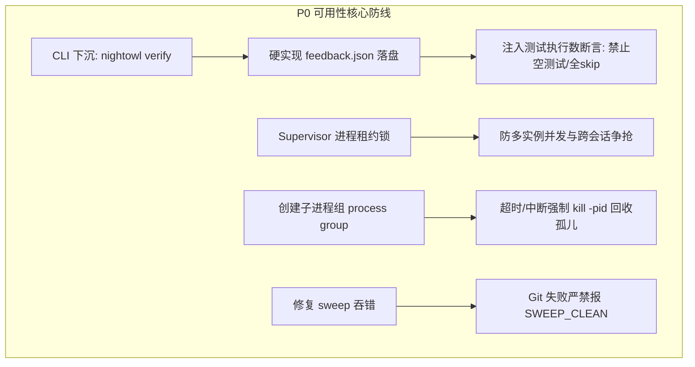
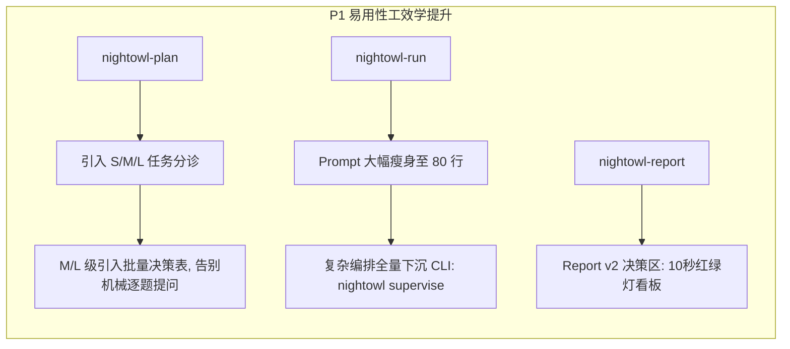

# Nightowl 技能体系可用性 (HA) 与易用性 (DX/AX) 深度专项分析与演进方案
## (In-depth Usability & Availability Audit Report: Cross-Agent Director Synthesis)

> **评审发起方**：Nightowl 架构委员会 (Director Mode)  
> **联合评审团队**：
> - 资深项目总监与系统架构师 (Antigravity Director)
> - 底层执行引擎与沙箱安全架构师 (Codex Worker, 模型: `gpt-5.6-sol`)
> - 开发者体验与认知工效学架构师 (OpenCode Worker, 模型: `opencode-go/muse-spark-1.3-contributor`)  
> **基准版本**：Nightowl v0.4.2 (Commit `9a68063`)  
> **评审对象**：`skills/nightowl-plan`、`skills/nightowl-run`、`skills/nightowl-verify`、`skills/nightowl-report` 及核心 CLI 状态机

---

## 1. 执行摘要与总体量化评估

在经过底层执行沙箱实测推演与交互认知链路审查后，联合评审团队一致得出结论：
**Nightowl 的技能框架在理念上极具前瞻性（状态外置、宿主无关、静默自治），但在“真实长任务可用性 (HA)”与“人/机协同易用性 (DX/AX)”上，存在显著的“技能契约膨胀”、“软规约伪装成硬保障”以及“状态机弱一致性”问题。**

### 1.1 技能体系多维量化评估矩阵 (雷达评分 1-10)

| 技能模块 | 可用性得分 (HA) | 易用性得分 (DX/AX) | 核心瓶颈诊断 | 综合评级 |
|---|:---:|:---:|---|:---:|
| **`nightowl-plan`** (规划审讯) | **7.5** | **4.5** | 机械式“逐题交互+强制2-4选项”造成严重摩擦；缺乏 S/M/L 分诊与快车道机制；验收门禁命令生成多为纯文本，未与 verify 联动。 | ⚠️ 体验僵化 |
| **`nightowl-run`** (静默自主) | **4.0** | **3.5** | 400+ 行 Prompt 导致 Agent 上下文注意力耗尽与严重指令漂移；进程树孤儿泄漏；worktree 冲突强删风险；缺乏多实例 Lease 互斥。 | ❌ 高危脆弱 |
| **`nightowl-verify`** (独立验证) | **3.0** | **5.0** | **规约与实现严重脱节**（宣称的 `feedback.json`、patch hash 震荡守卫、L0-L3 门禁在 CLI 未实现）；测试全 skip/恒真仍报 PASS；`--dir`/`--cwd` 路径双轨割裂。 | ❌ 假全绿虚标 |
| **`nightowl-report`** (收尾汇报) | **6.0** | **5.5** | 存在 Stale Report 污染未清理；报告仅为冰冷的长表格与 raw git log，缺乏管理者 10 秒决策区、工时偏差、审查打回与震荡统计。 | ⚠️ 决策力不足 |
| **CLI 基础设施** (CLI Core) | **5.5** | **4.0** | 报错缺乏“复制即用 Next Action”自愈命令；`sweep` 失败吞错报喜 (`SWEEP_CLEAN`)；`pool/state/checkpoint` 非事务写入。 | ⚠️ 基础脆弱 |

---

## 2. 可用性 (Availability & Reliability) 深度审查发现 (Codex 视角)

### 2.1 P0: 状态机弱一致性与中断恢复假死
1. **三态非事务断裂**：
   - 当前系统的持久化依赖 `pool.json`、`state.json` 与 `checkpoint.json` 三个独立文件，通过 `fs.writeFileSync` 分别落盘。
   - **故障推演**：若 `nightowl done` 在更新 `pool.json` 之后、更新 `state.json` 或创建 Git commit 之前发生进程崩溃（OOM 或宿主中断），系统将陷入永久死锁 —— `pool.json` 标记任务为完成，但 `state.json` 记录未完成，无法再次认领该任务。
2. **Checkpoint 旧进度无条件回滚风险**：
   - `resume` 命令直接读取旧 checkpoint 恢复，没有基于版本号/时间戳的 CAS (Compare-And-Swap) 或 Generation 校验机制。若中途手工或其它任务推进了状态，旧 checkpoint 会直接覆盖最新状态，造成不可逆的状态倒退。
3. **缺失 Supervisor 单实例租约锁 (Lease)**：
   - 缺少全局进程级互斥锁。若用户在另一个终端或另一个 Agent 会话中误起 `nightowl supervise` 或 `nightowl-run`，两实例将发生任务争抢，同时操作同一 worktree 导致代码互相覆盖。

### 2.2 P0: 进程树与孤儿进程污染
- **Node spawn 未开启进程组 (Process Group)**：
  - `src/git.ts` 和验证执行中，子进程派发未设置 `detached: true` 与 `kill(-pid)`。当测试命令超时（如 Vitest 陷入死循环挂起）或主代理超时中断时，仅杀死了顶层 shell，其底层的 Node/Python/Java 子孙进程依然存活。
  - **严重后果**：孤儿测试进程在后台继续持有端口、读写 worktree 目录，导致下一轮任务的 `worktree cleanup` 或 `worktree setup` 因文件锁被占用而崩溃。

### 2.3 P0: 虚假全绿与规约欺骗 (Spec Gap)
- **`nightowl-verify/SKILL.md` 规约冒充实现**：
  - 文档声称具有：`feedback.json` 纯净错误诊断落盘、测试执行数与 skip 数校验、恒真测试识别、patch hash 反震荡拦截。
  - **代码实测定位**：在 `src/commands/verify.ts` 与 `src/commands/supervise.ts` 中，上述功能**完全没有一行代码实现**！
  - **灾难场景**：子代理为图省事将测试用例改为 `test.skip(...)`，Vitest 退出码为 0，CLI 盲目判定 `VERIFY_RESULT: PASS` 并放行合并，产生严重的生产级逻辑漏洞。

### 2.4 P1: Worktree 故障态非安全收尾
- **`cleanup` 默认强删丢代码**：
  - `src/commands/worktree.ts` 中 `cleanup` 默认传递 `force: true`。若合并发生冲突或存在未提交的代码，执行 cleanup 会将开发者或 Agent 耗费数小时编写的成果瞬间永久擦除。
- **`setup` 半步失败死锁**：
  - 若 `mkdirSync` 创建了目录但随后的 `git worktree add` 失败，残留的空目录会导致后续调用误判 `WORKTREE_EXISTS`，永久阻断任务执行。

---

## 3. 易用性与工效学 (Usability & Cognitive Load) 深度审查发现 (OpenCode 视角)

### 3.1 P0: Agent 注意力预算击穿 (Prompt Drift)
- **`nightowl-run` 400+ 行 Prompt 膨胀**：
  - 当前技能将大量属于底层 CLI 职责的逻辑（平台判断、自检重铺、未跟踪文件分类决策树、worktree 参数组装、supervise 退出码解析）全部写在自然语言 Prompt 中。
  - **Agent 行为退化**：长会话执行到第 3 个任务以后，LLM 注意力严重衰减，普遍遗漏 worktree cleanup、漏传 `--cwd`、或在合并失败时不知所措。
  - **破局点**：必须将状态机编排逻辑彻底下沉到 CLI（如 `nightowl run-loop` / `nightowl supervise`），技能 Prompt 压缩至 80 行以内。

### 3.2 P1: `nightowl-plan` 审讯式交互的严重摩擦 (Interrogation Fatigue)
- **“一题一问+强制2-4选项”流程僵化**：
  - 无论需求复杂度（哪怕只是修一个 Typo 或加个配置字段），Prompt 强制要求逐题提问并必须给出选项。
  - 导致开发者体验极差，小任务场景下被用户强行放弃使用。
- **缺少分诊机制与快车道 (Fast-Track)**：
  - 未区分 S（小改动）、M（单功能）、L（复杂重构）。
  - S 级应允许“一次性确认+零提问自动开工”；M 级提供自动化探索后的“批量决策表”；仅 L 级才启用深度的交互审讯。

### 3.3 P1: CLI 报错的人性化与自愈引导缺失
- **缺乏“复制即用 Next Action”**：
  - 当触发 `noPool` 时，只提示“请先运行 nightowl init”，而 `init` 实际上需要必填 `-u <name> --platform <type>`，导致新手直接卡死；
  - `skillsOutdated` 提示重铺时，漏掉了 `--skip-permissions`，导致用户重铺时被权限改写惊吓；
  - `worktree: WORKTREE_EXISTS` 只输出原始机读码，未给出 `nightowl worktree cleanup <id>` 解决命令；
  - `sweep` 在 git 失败时竟然吞错报出 `SWEEP_CLEAN`，造成最危险的误导。

### 3.4 P1: `nightowl-report` 管理者价值不足
- **缺乏 10 秒决策区 (Executive Summary)**：
  - 汇报产出只是一堆表格和 raw git log。管理者在晨会或 PR 评审时，无法快速获知“是否建议发版”、“耗时偏差率”、“阻塞的 P0 任务”、“测试震荡返工率”。

---

## 4. 架构重构蓝图与分级演进路线 (Actionable Roadmap)

### 4.1 P0 级演进：紧急可用性止血与契约闭环 (1-2 天内落地)



1. **Verify 契约补齐（消灭虚假全绿）**：
   - 在 `src/commands/verify.ts` 中真实落地 `feedback.json` 写入；
   - 增加测试结果解析：检查 `numPassedTests > 0` 且 `numPendingTests == 0`（如全 skip 必须判定失败）；
   - 统一使用 `--id` 自动解析 worktree 路径，消灭 `--dir` 与 `--cwd` 的路径计算心智负担。
2. **Supervisor 进程租约与孤儿进程回收**：
   - 增加 `.nightowl/supervisor.lock`，基于 PID + 租约心跳，防止多终端/多 Agent 并发启动冲突；
   - 对所有 shell 及测试执行开启进程组，超时直接回收整个进程树。
3. **修复 `sweep` 吞错**：
   - `src/commands/sweep.ts` 中 git 命令执行失败时必须 fail-closed，抛出明确错误与排查命令，严禁报出 `SWEEP_CLEAN`。

### 4.2 P1 级演进：易用性瘦身与分诊交互重构 (1 周内落地)



1. **`nightowl-plan` 分诊与快车道**：
   - **S 级（<30min, <3 文件）**：自检通过直接生成 Plan，免交互问答；
   - **M 级（单模块新增/重构）**：Agent 自动勘察后，一次性给出包含 3~5 项设计抉择的“批量决策表格”，一次交互定案；
   - **L 级（跨系统重构）**：保持分层提问，但每问附带自动探查的上下文依据。
2. **`nightowl-run` 瘦身下沉**：
   - 将“未跟踪文件分类决策树”、“worktree 差异抹平”、“supervise 轮询状态机”从 SKILL.md 剥离，封装为 `nightowl run` 或增强版 `nightowl supervise`；
   - SKILL.md 压缩至两页以内，只保留关键心智模型。
3. **CLI Error Envelope 全局自愈化**：
   - 所有 CLI 阻断性报错均统一包含：
     ```
     ❌ [错误原因简述]
        ↪ 推荐解决命令 (复制即用): nightowl <cmd> ...
        ↪ 兜底选项: nightowl <cmd> --force
     ```
4. **`nightowl-report v2` 决策看板**：
   - 报告第一屏固定为 **“🚦 10秒决策区”**：
     - 发版判定（Green/Yellow/Red）；
     - 任务工时偏差比率（预估 vs 实际）；
     - 审查打回返工率与震荡警报；
     - Git 提交按 `[#<id>]` 聚合呈现。

### 4.3 P2 级演进：企业级高可用与反震荡守卫 (2-3 周)
1. **补丁哈希反震荡守卫 (Patch Hash Anti-Oscillation)**：
   - 记录每次 attempt 生成的 git diff SHA256；连续两次 diff 相同或互逆时，自动熔断并标记 `OSCILLATION_BLOCKED`，防止模型原地打转浪费 Token。
2. **状态机事务化与 Generation 版本化**：
   - 合并 `pool.json`、`state.json` 与 `checkpoint.json` 的更新事件，引入 `generation` 字段，实现严格的单向递增事务状态机。

---

## 5. 结论

通过本次 Codex（底层可用性视角）与 OpenCode（开发者体验视角）的双 Agent 深度穿透，我们锁定了现有体系中“可用性虚标”与“易用性摩擦”的核心病灶。按照上述 P0/P1 路线图重构后，Nightowl 将真正具备应对**24 小时复杂生产级无人值守长任务**的钢铁防线，同时为开发者与 Agent 提供极度顺滑的认知工效体验。
