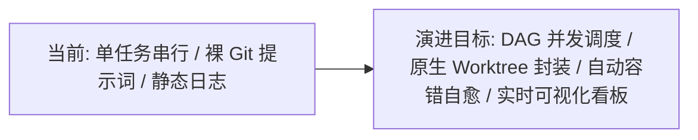
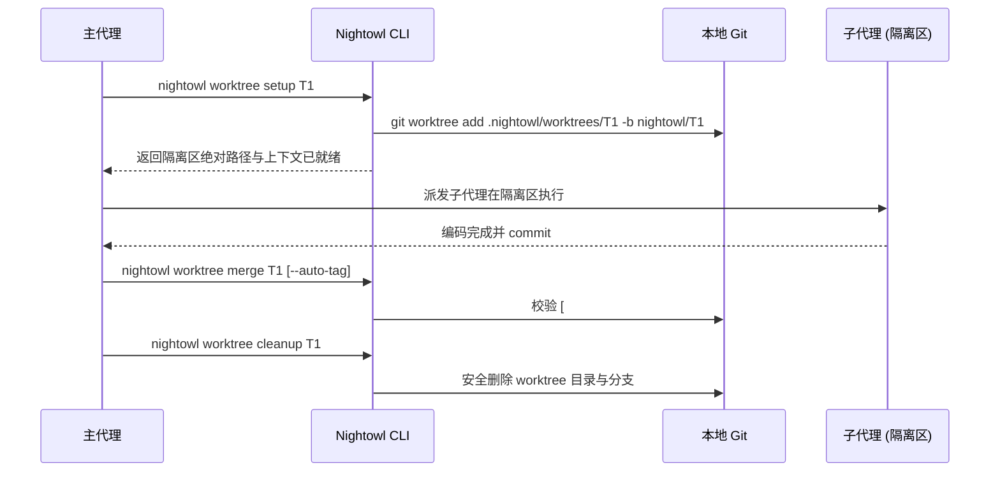
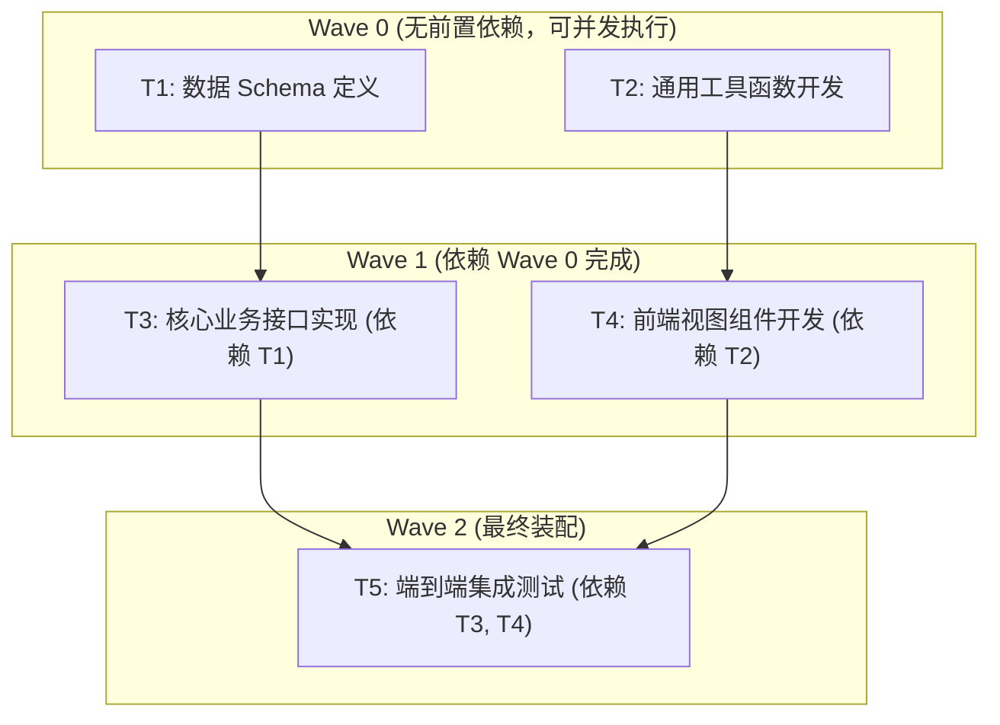
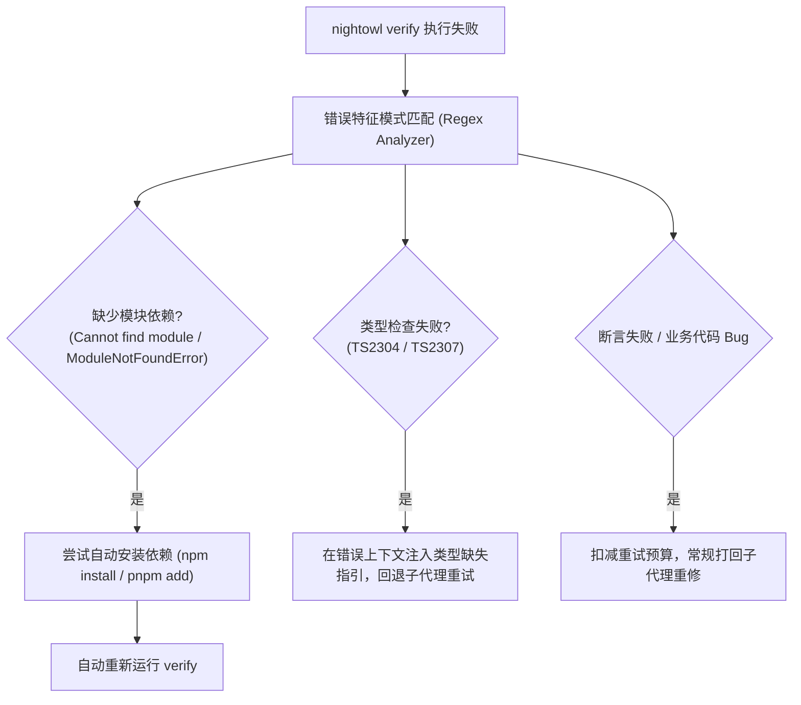

# Nightowl 架构演进与全景升级规划规范 (Architecture Evolution Roadmap)

---

## 一、 规划背景与演进愿景

### 1.1 现状与基线
`Nightowl` 在当前版本（0.4.x）已实现：
- **状态驱动的核心流水线**：Plan（交互分析）➔ Run（静默执行）➔ Report（收尾汇总）；
- **全平台真机实测**：Claude Code、Codex、Antigravity、OpenCode 均完成 CLI 契约与无交互会话实证；
- **防虚假完成三道铁门**：Verify 测试关口、Review 独立审查、Done Git commit 标记硬核验；
- **无人值守守护引擎**：`nightowl supervise` 的多轮会话驱动、退避重试、死锁拦截与收尾兜底。

### 1.2 演进目标
在保持**低依赖、状态外置、跨 Agent 平台中立**的前提下，将 Nightowl 从“**单任务串行执行器**”升级为“**高吞吐、强自愈、可观测的企业级多 Agent 自动化编排引擎**”。



---

## 二、 核心演进模块技术方案

### 模块 1：CLI 原生 Worktree 生命周期管控与自愈 (`nightowl worktree`)

#### 痛点与风险
在 Codex、Antigravity、OpenCode 平台中，主代理目前需通过 Prompt 组合执行复杂的 Bash 命令（`git worktree add`, `git merge`, `git worktree remove`）。大模型偶尔会出现路径拼错、分支遗漏、未清理孤儿 worktree 等确定性问题。

#### 架构设计
由 Nightowl CLI 原生接管隔离工作区的完整生命周期，对外暴露确定性的原子子命令：



#### 接口规范
1. `nightowl worktree setup <id>`
   - 自动生成标准化分支名 `nightowl/<id>` 与隔离路径 `.nightowl/worktrees/<id>`；
   - 自动在隔离区同步当前 `.nightowl/nightowl.context.md` 与 PRD 文档；
   - 标准输出打印当前隔离区绝对路径 `WORKTREE_DIR: <path>`。
2. `nightowl worktree merge <id> [--auto-tag]`
   - 检查目标分支的最新 commit；
   - 若开启 `--auto-tag` 且 commit message 缺少 `[#<id>]`，自动执行 `git commit --amend` 补齐标记；
   - 将变更合回当前主分支（Fast-forward 或 Merge commit）。
3. `nightowl worktree cleanup <id>`
   - 幂等清理 `.nightowl/worktrees/<id>` 并删除临时分支 `nightowl/<id>`。

---

### 模块 2：DAG 拓扑分层与并行波次调度 (Parallel Wave Scheduling)

#### 痛点与收益
当前调度器每次只调度单任务。对于存在多个独立子模块（如数据层、接口层、前端组件）的项目，总耗时为所有任务耗时串行累加。并行调度可将整体耗时缩短 **50%~80%**。

#### 拓扑分层模型设计
通过对 `nightowl.tasks.yaml` 中的任务拓扑图进行广度优先分层算法（Kahn 算法变种），计算出相互解耦的并发执行波次（Waves）：



#### 运行态状态机扩展 (`nightowl.state.yaml`)
平滑升级状态存储结构以支持多任务并行态：
```yaml
# 兼容升级: in_progress 从单一对象升级为数组
in_progress:
  - id: T1
    worktree: .nightowl/worktrees/T1
    started_at: "2026-10-14T10:00:00Z"
  - id: T2
    worktree: .nightowl/worktrees/T2
    started_at: "2026-10-14T10:00:05Z"
completed: [...]
blocked: [...]
```

#### 并行冲突仲裁机制
- 先完成并验证通过的任务优先合回主分支；
- 后完成的任务合并时若遭遇代码冲突（Git Conflict）：
  - 自动触发冲突仲裁钩子，派发审查子代理执行三方合并（Three-way merge）；
  - 若仲裁失败，该任务安全降级进入 `blocked`，不影响同波次其他分支的推进。

---

### 模块 3：智能容错自愈与失败智能归因 (Self-Healing & Error Triage)

#### 痛点
在无人值守过程中，子代理偶发因为“缺失依赖包（如第三方库未安装）”或“测试环境变量不匹配”导致 `verify` 失败，盲目重试会快速吃光重试预算（Retry Budget）并导致任务阻塞。

#### 自愈引擎架构


---

### 模块 4：可观测性与实时看板系统 (Observability & TUI/Web Dashboard)

#### 终端实时看板 (`nightowl status --watch`)
采用无外部重型依赖的 ANSI 控制台渲染引擎，提供实时沉浸式监控界面：
- **顶部**：项目总览、运行环境、平台宿主（Codex / AGY / Claude / OpenCode）、当前模式；
- **中部**：DAG 任务拓扑图、波次进度条、当前并发中的子代理；
- **底部**：最近提交历史、系统级日志流与容灾检查点状态。

#### 本地极简看板服务 (`nightowl serve`)
- 基于 Node.js 内置 `node:http` 模块实现零新依赖启动（默认端口 `4310`）；
- 产出轻量 HTML 页面，提供：
  - 交互式甘特图（Gantt Chart）：任务预估时间 vs 实际耗时对比；
  - 审查记录时间轴与代码审查 Diff 抽屉式查看；
  - 实时读取 `.nightowl/nightowl.state.yaml` 与 `nightowl.log`。

---

## 三、 分阶段实施路线图 (TODO List & Roadmap)

| 阶段 | 周期 | 核心交付物 | 质量目标 |
| :---: | :--- | :--- | :--- |
| **Phase 1: 稳定性与原子工具封装** | 近期 (P0) | 1. 实现 `nightowl worktree <setup\|merge\|cleanup>` 子命令<br>2. `nightowl done` 支持 `--auto-tag` 标记补齐<br>3. 适配更新各平台技能正文模板 | 100% 单元测试覆盖，真机隔离消除裸 Git 操作漂移 |
| **Phase 2: 并行调度核心演进** | 中期 (P1) | 1. 扩展调度器支持 DAG 波次计算<br>2. `state.yaml` 支持多 `in_progress` 数组存储<br>3. `supervise` 支持 `--concurrency <n>` 并行驱动 | 并发调度多任务吞吐效率提升 200% 以上 |
| **Phase 3: 容错自愈与失败分类** | 中期 (P1) | 1. 验收命令输出模式识别引擎<br>2. 依赖缺失自动补偿修复机制<br>3. 审查子代理三方合并冲突解决协议 | 减少 80% 由于非代码逻辑原因造成的无效阻塞 |
| **Phase 4: 可观测性与交互质变** | 远期 (P2) | 1. `nightowl status --watch` 终端控制台看板<br>2. `nightowl serve` 零依赖本地轻量 Web 甘特图与 Diff 查看 | 提供现代化的开发者可视化与夜间监控体验 |

---

## 四、 架构兼容性与平滑迁移原则

1. **配置与状态无损迁移**：
   - 现有的 `nightowl.tasks.yaml` 格式完全保持兼容；
   - `nightowl.state.yaml` 在读取旧版单对象 `in_progress` 时自动兼容提升为数组。
2. **包升级与技能重铺幂等性**：
   - 继续严格遵照 `.nightowl/.template-hashes.json` 的版本戳追踪机制；
   - 演进版本发布后，运行 `nightowl init --skip-permissions` 即可无损同步最新技能模板，本地定制文件受到 hash 保护不被破坏。
3. **零引入重量级外部依赖**：
   - 保持生产依赖最小化（保留轻量级 `commander` 与 `js-yaml`），TUI 与 Web 服务均优先采用 Node.js 原生 API 实现，保障全局 CLI 的极速安装与轻便分发。
